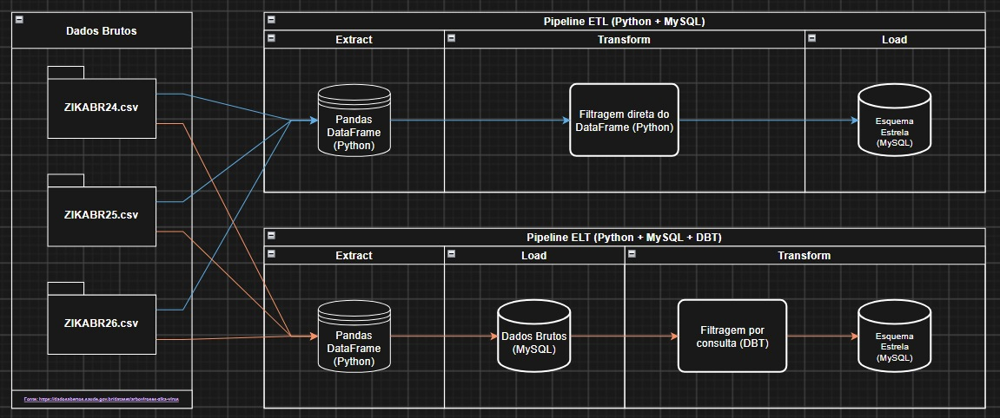

# Integração de dados — Zika/SINAN (2024–2026)

Projeto de Banco de Dados, CIn/UFPE. Integra `ZIKABR24.csv`, `ZIKABR25.csv` e
`ZIKABR26.csv` em um esquema estrela com **cinco dimensões e uma fato**.
Os dois pipelines publicam **o mesmo esquema MySQL, com os mesmos dados e regras**.



- **ETL:** CSVs → Pandas → filtragem, decodificação e modelagem em memória → esquema estrela MySQL.
- **ELT:** CSVs → Pandas textual → staging bruto MySQL → consultas SQL com dbt → esquema estrela MySQL.

## Arquivos

| Caminho | Conteúdo |
|---|---|
| `dados/ZIKABR{24,25,26}.csv` | Três bases brutas, 38 campos e 82.460 linhas no total |
| `notebooks/pipeline_ETL.ipynb` | Execução ETL em etapas, com transformação em Python |
| `notebooks/pipeline_ELT_completo_executado.ipynb` | Execução ELT com MySQL e dbt; saídas antigas removidas |
| `notebooks/analises_zika.ipynb` | Consultas e três visualizações, separadas dos pipelines |
| `pipelines/core.py` | Extração e transformação ETL |
| `pipelines/run.py` | Orquestração por linha de comando |
| `pipelines/contrato.json` | Colunas, tipos, domínios e UFs compartilhados |
| `dbt/models/` | Transformações SQL ELT e modelos intermediários |
| `dbt/tests/` | Reconciliação e regras de métricas |
| `sql/01_script_ddl_do_esquema_estrela.sql` | DDL MySQL comum com PKs, FKs e checks |
| `docs/dicionario_de_dados_e_mapeamento_de_divergencias.md` | Dicionário completo e regras de integração |
| `docs/relatorio_projeto_integracao.md` | Relatório com referência ao dicionário |

## Execução local ou Colab

Requisitos: **Python 3.10–3.12** e **MySQL 8.0.16+** acessível pelo ambiente Python.
O adapter comunitário `dbt-mysql==1.7.0` usa dbt Core 1.7; as versões estão delimitadas
em `requirements.txt`. Veja a [documentação do adapter](https://github.com/dbeatty10/dbt-mysql#configuring-your-profile).

Na raiz do clone:

```bash
python3 -m venv .venv
source .venv/bin/activate
pip install -r requirements.txt
```

Crie um banco dedicado uma única vez no MySQL:

```sql
CREATE DATABASE zika_dw CHARACTER SET utf8mb4 COLLATE utf8mb4_0900_bin;
```

Configure a conexão no ambiente. `.env.example` lista as opções; os scripts não carregam `.env`
automaticamente. Use um usuário com permissões de criar, ler, alterar e remover tabelas nesse banco.

```bash
export MYSQL_HOST=127.0.0.1
export MYSQL_PORT=3306
export MYSQL_USER=root
export MYSQL_DATABASE=zika_dw
read -rsp 'Senha MySQL: ' MYSQL_PASSWORD
export MYSQL_PASSWORD
```

Escolha um fluxo (ou execute ambos sequencialmente para comparar):

```bash
python -m pipelines.run etl
python -m pipelines.run elt
```

O ETL termina a transformação e a construção das dimensões antes da conexão ao banco.
O ELT carrega os valores originais em `stg_zika`, executa `dbt build` e publica as tabelas
`elt_dim_*`/`elt_fato_notificacao_zika` no esquema final usando `INSERT ... SELECT`.
O dbt resolve as dependências com `source()` e `ref()` e testa as chaves e relações.

Ambos substituem o conteúdo das **seis tabelas estrela** em uma transação, sem remover
as tabelas. Falhas de publicação causam rollback. No ELT, staging e modelos intermediários
são reconstruídos antes da publicação. Não execute cargas simultâneas no mesmo banco.
Para preservar duas saídas para comparação, use bancos dedicados diferentes.

O DDL usa `CREATE TABLE IF NOT EXISTS`: para bancos legados com outro esquema, use um
**novo banco dedicado**. O pipeline não migra nem apaga tabelas legadas automaticamente.

As contagens e o tempo de execução ficam em `saidas/etl/manifesto.json` e
`saidas/elt/manifesto.json`. `ZIKA_DATA_DIR` permite trocar a pasta de entrada;
`ZIKA_OUTPUT_DIR` permite trocar a pasta de saída. Rejeições ETL ficam em CSV e rejeições
ELT em `elt_rejeitados`, com origem e motivo.

No Colab, clone o repositório, entre em sua raiz com `%cd`, instale com
`%pip install -r requirements.txt`, configure o MySQL acessível e execute o notebook escolhido
em ordem. Os notebooks também funcionam quando abertos na pasta `notebooks/` do clone.

## Contrato e validação

O [dicionário](docs/dicionario_de_dados_e_mapeamento_de_divergencias.md) contém os tipos,
os mapeamentos e as regras comuns. Deduplicação considera os 38 campos originais;
registros com dados diferentes são preservados, pois não há identificador único na extração.
Na entrada atual: **82.460 brutas = 56 duplicatas exatas + 0 rejeições + 82.404 válidas**.

Após alterar os domínios do contrato, regenere os modelos SQL:

```bash
python -m pipelines.generate_dbt
python -m unittest tests.test_pipelines
```

O teste de integração exige MySQL e um usuário autorizado a criar/remover bancos de teste:

```bash
python -m tests.integration_mysql
```

Ele cria um banco temporário com UUID, compara integralmente as seis tabelas entre ETL e
ELT, testa reexecução e casos de borda e remove somente o banco temporário ao terminar.
Também testa rollback após violação de FK. Os 26 testes do dbt são executados em cada ELT.

Os resultados verificados estão em [docs/validacao_pipelines.md](docs/validacao_pipelines.md).

## Análises e relatório

Abra `notebooks/analises_zika.ipynb` após concluir um dos fluxos. O notebook consulta o
esquema final e gera gráficos de sazonalidade, gestantes por UF e tempos da vigilância em
`saidas/analises/`. O relatório aponta para esse arquivo e para o dicionário.
2026 é parcial; os números antigos calculados antes da deduplicação devem ser recalculados.
O PDF comparativo existente é um artefato histórico, não a especificação dos fluxos atuais.

---

## Equipe e Divisão de Responsabilidades

| Integrante | Login CIn | Dupla / Frente Principal | Responsabilidades no Projeto |
| :--- | :--- | :--- | :--- |
| **Cauã Emanuel** | `ceor` | Dupla 1 — Arquitetura & ETL | Concepção da Macroentrega 1, Modelagem Star Schema, Dicionário de Dados, Pipeline ETL |
| **Allanis Beatriz** | `aboml` | Dupla 1 — Arquitetura & ETL | Desenvolvimento do Notebook Colab ETL, tratamento em Python/Pandas e carga dimensional |
| **Arthur Gabriel** | `agsl` | Dupla 2 — Engenharia ELT & BD | Configuração do SGBD, carga *Staging* e desenvolvimento do Notebook Colab ELT |
| **Allan Fernandes** | `afl4` | Dupla 2 — Engenharia ELT & BD | Scripts SQL de transformação interna (`02_transformacoes_elt.sql`) e comparativo ETL vs. ELT |
| **Felipe Melo** | `fma4` | Dupla 3 — Analytics & Docs | Diagrama de fluxo no Draw.io, Consultas SQL e Visualizações das 3 Análises e Insights |
| **Amanda Pereira** | `apmo` | Dupla 3 — Analytics & Docs | Consolidação do Relatório Final, Evidências Intermediárias e Slides da Apresentação |

---

## Padrão Obrigatório de Commits no GitHub

Para atender aos critérios de avaliação da disciplina, **todos os integrantes devem realizar commits utilizando suas próprias contas do GitHub** e seguir o padrão descritivo abaixo (mensagens genéricas como `"update"`, `"teste"` ou `"ajuste final"` são proibidas):

* `feat(etl): implementacao da decodificacao da coluna NU_IDADE_N nas bases de Zika 2024 a 2026`
* `feat(elt): criacao da query SQL de padronizacao de UF e deduplicacao temporal entre anos`
* `docs(relatorio): adicao dos graficos e insights da analise 1 sobre sazonalidade dos casos`
* `docs(arquitetura): inclusao do diagrama de integracao exportado do draw.io`