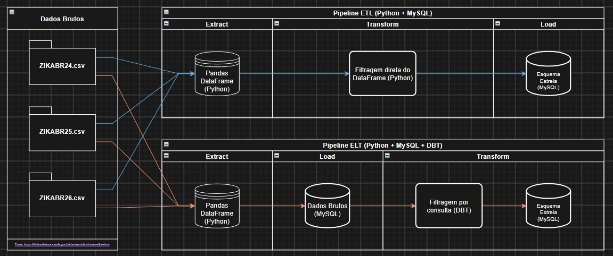

# Integração de dados — Zika/SINAN (2024–2026)

Projeto de Banco de Dados, CIn/UFPE — **2026.2**. Integra `ZIKABR24.csv`, `ZIKABR25.csv` e
`ZIKABR26.csv` em um esquema estrela com **cinco dimensões e uma fato**.
Os dois pipelines publicam **o mesmo esquema MySQL, com os mesmos dados e regras**.



- **ETL:** CSVs → Pandas → filtragem, decodificação e modelagem em memória → esquema estrela MySQL.
- **ELT:** CSVs → Pandas textual → staging bruto MySQL → consultas SQL com dbt → esquema estrela MySQL.

## Materiais da entrega de 18/11/2026

O [índice de entregáveis](docs/entregaveis.md) reúne os arquivos disponíveis, seu estado
e as pendências de integração. O relatório foi consolidado com três análises quantitativas e slides. A evidência ETL
Colab está disponível; a execução ELT em Colab e a conferência da publicação final
ainda precisam ser concluídas pela equipe. Veja a [revisão de conformidade](docs/revisao_entrega_18-11.md).

- [Relatório consolidado — sete seções](docs/relatorio_projeto_integracao.md)
- [Slides da apresentação](docs/apresentacao/apresentacao_zika.pptx) e [roteiro](docs/apresentacao/roteiro.md)
- [Evidência ETL Colab](docs/evidencias/etl_colab_executado.ipynb) e [validação atual das análises](docs/evidencias/validacao_analises.json)
- [Dicionário completo das seis tabelas](docs/dicionario_de_dados_e_mapeamento_de_divergencias.md)
- [Esquema estrela — imagem vetorial](docs/figuras/esquema_estrela.svg) e [PNG](docs/figuras/esquema_estrela.png)
- [Fonte, cobertura e limitações dos CSVs](dados/README_DADOS.md) e [inventário com SHA-256](dados/metadados_fontes.json)
- [Notebook ETL](notebooks/pipeline_ETL.ipynb), [notebook ELT](notebooks/pipeline_ELT_completo_executado.ipynb) e [análises](notebooks/analises_zika.ipynb)
- [Validação técnica de 13/11](docs/validacao_pipelines.md) e [revisão de arquitetura de 16/11](docs/evidencias/revisao_arquitetura_16-11.md)
- [Divisão de tarefas e checklist final](docs/plano_pendencias_18-11.md)

As cinco dimensões e a fato têm seis relações: `dim_tempo` é referenciada nos papéis de
notificação e sintomas. A fato conta linhas brutas válidas distintas; `dim_paciente`
representa perfis, sem identificar pessoas. [Detalhes da modelagem](docs/relatorio_projeto_integracao.md#11-arquitetura-do-esquema-estrela).

## Arquivos

| Caminho | Conteúdo |
|---|---|
| `dados/ZIKABR{24,25,26}.csv` | Três bases brutas, 38 campos e 82.460 linhas no total |
| `notebooks/pipeline_ETL.ipynb` | Execução ETL em etapas, com transformação em Python |
| `notebooks/pipeline_ELT_completo_executado.ipynb` | Execução ELT com MySQL e dbt; saídas antigas removidas |
| `notebooks/analises_zika.ipynb` | Três análises principais e três complementares, separadas dos pipelines |
| `pipelines/core.py` | Extração e transformação ETL |
| `pipelines/run.py` | Orquestração por linha de comando |
| `pipelines/contrato.json` | Colunas, tipos, domínios e UFs compartilhados |
| `dbt/models/` | Transformações SQL ELT e modelos intermediários |
| `dbt/tests/` | Reconciliação e regras de métricas |
| `sql/01_script_ddl_do_esquema_estrela.sql` | DDL MySQL comum com PKs, FKs e checks |
| `docs/dicionario_de_dados_e_mapeamento_de_divergencias.md` | Dicionário completo e regras de integração |
| `docs/relatorio_projeto_integracao.md` | Relatório com referência ao dicionário |
| `dados/metadados_fontes.json` | Inventário dos CSVs, hashes, cobertura e preenchimento |
| `scripts/auditar_fontes.py` | Reprodução do inventário, sem alterar as fontes |
| `docs/figuras/esquema_estrela.{dot,svg,png}` | Fonte editável e imagens da modelagem física |
| `docs/entregaveis.md` | Índice de entrega e pendências por material |

## Como executar

Requisitos: **Python 3.10–3.12** e **MySQL 8.0.16+** acessível pelo ambiente Python.
O adapter comunitário `dbt-mysql==1.7.0` usa dbt Core 1.7; as versões estão delimitadas
em `requirements.txt`. Veja a [documentação do adapter](https://github.com/dbeatty10/dbt-mysql#configuring-your-profile).

### Execução local

Com o MySQL instalado e iniciado, na raiz do clone:

```bash
python3 -m venv .venv
source .venv/bin/activate
pip install -r requirements.txt
```

Crie um banco dedicado uma única vez no MySQL:

```sql
CREATE DATABASE zika_dw CHARACTER SET utf8mb4 COLLATE utf8mb4_0900_bin;
```

Configure a conexão no ambiente. `.env.example` lista as opções; os scripts não carregam `.env`
automaticamente. Use um usuário com permissões de criar, ler, alterar e remover tabelas nesse banco.

```bash
export MYSQL_HOST=127.0.0.1
export MYSQL_PORT=3306
export MYSQL_USER=root
export MYSQL_DATABASE=zika_dw
read -rsp 'Senha MySQL: ' MYSQL_PASSWORD
export MYSQL_PASSWORD
```

Escolha um fluxo (ou execute ambos sequencialmente para comparar):

```bash
python -m pipelines.run etl
python -m pipelines.run elt
```

O ETL termina a transformação e a construção das dimensões antes da conexão ao banco.
O ELT carrega os valores originais em `stg_zika`, executa `dbt build` e publica as tabelas
`elt_dim_*`/`elt_fato_notificacao_zika` no esquema final usando `INSERT ... SELECT`.
O dbt resolve as dependências com `source()` e `ref()` e testa as chaves e relações.

Ambos substituem o conteúdo das **seis tabelas estrela** em uma transação, sem remover
as tabelas. Falhas de publicação causam rollback. No ELT, staging e modelos intermediários
são reconstruídos antes da publicação. Não execute cargas simultâneas no mesmo banco.
Para preservar duas saídas para comparação, use bancos dedicados diferentes.

O DDL usa `CREATE TABLE IF NOT EXISTS`: para bancos legados com outro esquema, use um
**novo banco dedicado**. O pipeline não migra nem apaga tabelas legadas automaticamente.

As contagens e o tempo de execução ficam em `saidas/etl/manifesto.json` e
`saidas/elt/manifesto.json`. `ZIKA_DATA_DIR` permite trocar a pasta de entrada;
`ZIKA_OUTPUT_DIR` permite trocar a pasta de saída. Rejeições ETL ficam em CSV e rejeições
ELT em `elt_rejeitados`, com origem e motivo.

### Google Colab com MySQL no próprio ambiente

Abra um notebook no Colab e execute cada bloco em uma célula, na ordem. Neste roteiro,
o MySQL será instalado dentro do ambiente Colab; portanto, `127.0.0.1` aponta para esse
servidor. Não é necessário ter MySQL instalado no computador pessoal.

**1. Instalar e iniciar o MySQL**

```python
!sudo apt-get update -qq
!sudo env DEBIAN_FRONTEND=noninteractive apt-get install -y mysql-server
!sudo service mysql start
!mysql --version
```

A instalação usa o pacote da distribuição Ubuntu. Veja a
[documentação de instalação do MySQL no Ubuntu](https://ubuntu.com/server/docs/how-to/databases/install-mysql/).
Confira se a versão atende ao requisito MySQL 8.0.16+.

**2. Clonar o repositório e instalar as dependências**

```python
!git clone https://github.com/CauaEmano/projeto-integracao-bd-cin.git
%cd /content/projeto-integracao-bd-cin
%pip install -r requirements.txt
```

Se o repositório já estiver clonado nessa sessão, pule a linha `git clone`.
Use um runtime Python compatível com os requisitos acima.

**3. Criar o banco e configurar a conexão**

Esta célula cria um banco dedicado e um usuário com acesso a ele. A senha é gerada
automaticamente, mantida em memória e usada pelos pipelines via variáveis de ambiente.

```python
import os
import secrets
import subprocess

senha = secrets.token_hex(16)

sql = f"""
CREATE DATABASE IF NOT EXISTS zika_dw
CHARACTER SET utf8mb4 COLLATE utf8mb4_0900_bin;

CREATE USER IF NOT EXISTS 'zika_colab'@'localhost'
IDENTIFIED BY '{senha}';

ALTER USER 'zika_colab'@'localhost'
IDENTIFIED BY '{senha}';

GRANT ALL PRIVILEGES ON zika_dw.*
TO 'zika_colab'@'localhost';
"""

resultado = subprocess.run(
    ["sudo", "mysql"],
    input=sql,
    text=True,
    check=True,
)

os.environ.update({
    "MYSQL_HOST": "127.0.0.1",
    "MYSQL_PORT": "3306",
    "MYSQL_USER": "zika_colab",
    "MYSQL_PASSWORD": senha,
    "MYSQL_DATABASE": "zika_dw",
})

print("Banco e conexão configurados.")
```

As tabelas finais são criadas pelo pipeline a partir do DDL; não é necessário criá-las
manualmente. Esse usuário tem acesso ao banco do projeto; ele não é destinado ao teste
`tests.integration_mysql`, que precisa criar e remover bancos temporários separados.

**4. Testar a conexão**

```python
from pipelines.database import connect

with connect() as conexao:
    with conexao.cursor() as cursor:
        cursor.execute("SELECT VERSION(), DATABASE()")
        print(cursor.fetchone())
```

O resultado deve mostrar a versão do MySQL e o banco `zika_dw`. Se essa etapa falhar,
resolva a conexão antes de executar a carga.

**5. Executar o pipeline escolhido**

Para ELT, com transformação SQL/dbt dentro do MySQL:

```python
from pipelines.run import run

manifesto = run("elt")
```

Para ETL, com transformação em Python antes da carga:

```python
from pipelines.run import run

manifesto = run("etl")
```

Escolha um dos blocos ou execute-os sequencialmente. **Cada execução substitui o conteúdo
das seis tabelas finais no banco configurado.** O manifesto apresenta as contagens e o
tempo total, além de ser salvo em `saidas/etl/` ou `saidas/elt/`.

**6. Conferir o resultado no banco**

```python
with connect() as conexao:
    with conexao.cursor() as cursor:
        cursor.execute("SELECT COUNT(*) FROM fato_notificacao_zika")
        print("Registros na fato:", cursor.fetchone()[0])
```

Com os CSVs auditados do projeto, o esperado é **82.404 registros**. Outra versão das fontes
pode produzir outra contagem. Para as três análises, execute as células de
[`notebooks/analises_zika.ipynb`](notebooks/analises_zika.ipynb) após a carga.

Para demonstrar os notebooks ETL e ELT em etapas, execute as células dos arquivos em
`notebooks/` depois de preparar o clone, as dependências e as variáveis acima, no mesmo
runtime. Os notebooks também funcionam a partir da pasta `notebooks/` do clone. As
configurações e os imports feitos em um runtime não são transferidos automaticamente
para outro notebook conectado a um runtime diferente.

Se o ambiente Colab for excluído ou recriado, refaça a preparação: o servidor e os dados
instalados nele são temporários. Baixe as evidências e os manifestos antes de encerrar a
sessão. Este roteiro ainda precisa ser validado pela equipe no runtime Colab usado na
entrega; ele não representa evidência de execução já realizada.

### Google Colab com um servidor MySQL externo

Se a equipe já possui um MySQL acessível pelo Colab, use o clone e as dependências do
passo 2 e configure a conexão abaixo, em vez de instalar o MySQL localmente e executar
o passo 3. O banco dedicado deve existir e o usuário deve ter permissões nesse banco.

```python
import getpass
import os

os.environ['MYSQL_HOST'] = input('Host MySQL acessível pelo Colab: ').strip()
os.environ['MYSQL_PORT'] = input('Porta MySQL [3306]: ').strip() or '3306'
os.environ['MYSQL_USER'] = input('Usuário MySQL: ').strip()
os.environ['MYSQL_DATABASE'] = input('Banco dedicado já criado: ').strip()
os.environ['MYSQL_PASSWORD'] = getpass.getpass('Senha MySQL: ')
```

Em seguida, teste a conexão e execute a carga conforme os passos 4 a 6. Para essa opção,
`127.0.0.1` não é o endereço do MySQL do computador pessoal: informe o host efetivamente
acessível pelo runtime Colab.

## Contrato e validação

O [dicionário](docs/dicionario_de_dados_e_mapeamento_de_divergencias.md) contém os tipos,
os mapeamentos e as regras comuns. Deduplicação considera os 38 campos originais;
registros com dados diferentes são preservados, pois não há identificador único na extração.
Na entrada atual: **82.460 brutas = 56 duplicatas exatas + 0 rejeições + 82.404 válidas**.

Após alterar os domínios do contrato, regenere os modelos SQL:

```bash
python -m pipelines.generate_dbt
python -m unittest tests.test_pipelines
```

O teste de integração exige MySQL e um usuário autorizado a criar/remover bancos de teste:

```bash
python -m tests.integration_mysql
```

Ele cria um banco temporário com UUID, compara integralmente as seis tabelas entre ETL e
ELT, testa reexecução e casos de borda e remove somente o banco temporário ao terminar.
Também testa rollback após violação de FK. Os 26 testes do dbt são executados em cada ELT.

Os resultados verificados estão em [docs/validacao_pipelines.md](docs/validacao_pipelines.md).

Para refazer o inventário dos arquivos locais, sem dependências Python adicionais:

```bash
python3 scripts/auditar_fontes.py
```

A data original de download não foi registrada. A consulta ao portal em 16/11/2026 e
os hashes locais não comprovam igualdade com a versão atual publicada na fonte.

## Análises e relatório

Abra `notebooks/analises_zika.ipynb` após concluir um dos fluxos. O notebook consulta o
esquema final e gera gráficos de sazonalidade, gestantes por UF e tempos da vigilância em
`saidas/analises/`. O relatório aponta para esse arquivo e para o dicionário.
2026 é parcial. Os resultados revisados estão em `docs/analises/`, com tabelas em
`docs/analises/tabelas/`. O comparativo vigente é a seção 5 do relatório. Materiais
anteriores foram preservados em `docs/historico/`, fora do pacote de entrega.

Para reproduzir os números e verificar as seis células analíticas sem servidor MySQL:

```bash
python -m scripts.validar_analises
```

Esse comando reconstrói a estrela ETL e executa as consultas em SQLite em memória.
Ele não substitui a integração MySQL nem comprova execução em Colab.

`saidas/` e `dbt/target/` são ignorados pelo Git. Evidências selecionadas para entrega
devem ir para `docs/evidencias/` e gráficos finais para `docs/figuras/`, com origem e data.
Os notebooks-fonte ficam sem saídas salvas conforme o teste de limpeza; vincule os logs,
prints ou cópias executadas externas a partir do [índice de entregáveis](docs/entregaveis.md).
Os manifestos citados acima são gerados pela CLI; o notebook ETL em etapas imprime
auditoria e contagens, mas não grava automaticamente aquele manifesto.

---

## Equipe e Divisão de Responsabilidades

| Integrante | Login CIn | Dupla / Frente Principal | Responsabilidades no Projeto |
| :--- | :--- | :--- | :--- |
| **Cauã Emanuel** | `ceor` | Dupla 1 — Arquitetura & ETL | Concepção da Macroentrega 1, Modelagem Star Schema, Dicionário de Dados, Pipeline ETL |
| **Allanis Beatriz** | `aboml` | Dupla 1 — Arquitetura & ETL | Desenvolvimento do Notebook Colab ETL, tratamento em Python/Pandas e carga dimensional |
| **Arthur Gabriel** | `agsl` | Dupla 2 — Engenharia ELT & BD | Configuração do SGBD, carga *Staging* e desenvolvimento do Notebook Colab ELT |
| **Allan Fernandes** | `afl4` | Dupla 2 — Engenharia ELT & BD | Transformações SQL em `dbt/models/`, reconciliação e comparativo ETL vs. ELT |
| **Felipe Melo** | `fma4` | Dupla 3 — Analytics & Docs | Diagrama de fluxo no Draw.io, Consultas SQL e Visualizações das 3 Análises e Insights |
| **Amanda Pereira** | `apmo` | Dupla 3 — Analytics & Docs | Consolidação do Relatório Final, Evidências Intermediárias e Slides da Apresentação |

---

## Padrão Obrigatório de Commits no GitHub

Para atender aos critérios de avaliação da disciplina, **todos os integrantes devem realizar commits utilizando suas próprias contas do GitHub** e seguir o padrão descritivo abaixo (mensagens genéricas como `"update"`, `"teste"` ou `"ajuste final"` são proibidas):

* `feat(etl): implementacao da decodificacao da coluna NU_IDADE_N nas bases de Zika 2024 a 2026`
* `feat(elt): criacao da query SQL de padronizacao de UF e deduplicacao temporal entre anos`
* `docs(relatorio): adicao dos graficos e insights da analise 1 sobre sazonalidade dos casos`
* `docs(arquitetura): inclusao do diagrama de integracao exportado do draw.io`
