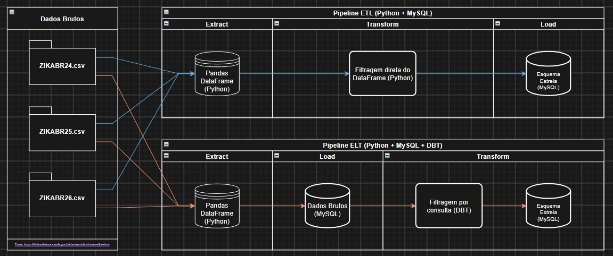
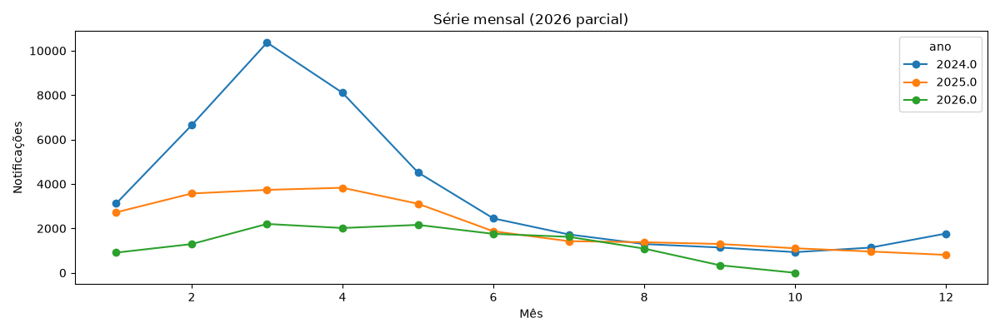
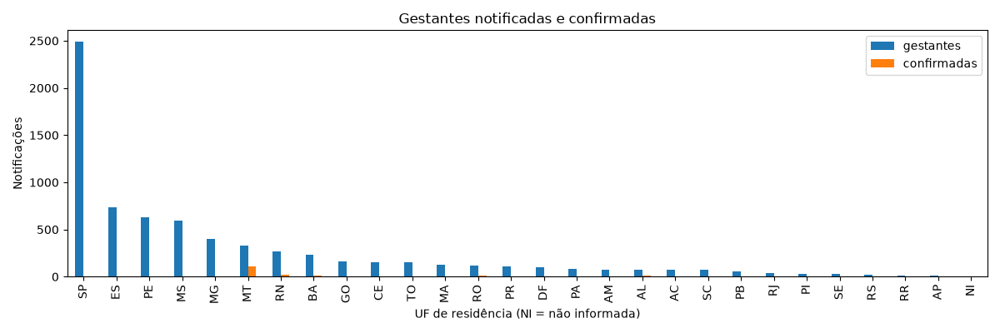
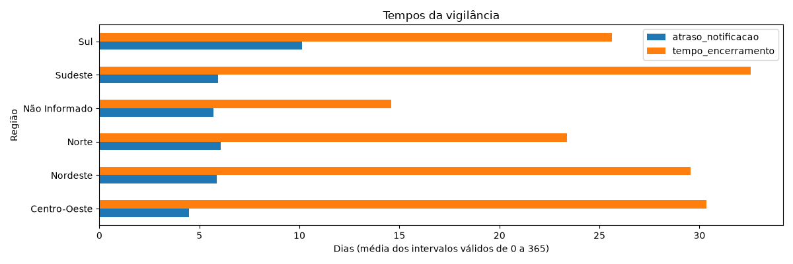

# Roteiro da apresentação

## 1. Integração de dados de Zika

SINAN • 2024–2026
Banco de Dados • CIn / UFPE • 2026.2
ETL e ELT sobre um mesmo esquema estrela

Notas: README.md; docs/relatorio_projeto_integracao.md

## 2. Três extrações, 82.460 linhas brutas

Fonte declarada: SINAN / Ministério da Saúde.
2024: 43.312 • 2025: 25.764 • 2026: 13.384 linhas.
38 campos comuns: notificações, perfil, localização e investigação.
Tema permite cruzar tempo, gestação e desfecho; 2026 é parcial.

Notas: dados/README_DADOS.md; dados/metadados_fontes.json

## 3. O layout é igual; a cobertura varia

Datas observadas: 2024-01-01 a 2026-10-05 no conjunto.
69 linhas de ZIKABR24 e 12 de ZIKABR25 têm ano diferente do arquivo.
Calendário analítico: DT_NOTIFIC, preservando essas linhas.
CLASSI_FIN vazio: 537 / 433 / 754 linhas por extração.

Notas: dados/metadados_fontes.json. Datas extremas não garantem completude. Não foi registrada a data original de download.

## 4. Tecnologias e escolhas

Python / Pandas: leitura textual, inspeção e transformação ETL.
MySQL: armazenamento, chaves estrangeiras e publicação transacional.
dbt: transformação SQL, dependências e testes ELT.
Colab: ambiente de demonstração; GitHub: código e autoria.

Notas: requirements.txt; pipelines/; dbt/; README.md

## 5. Dois caminhos para a mesma estrela

Notas: ETL transforma em Python antes da carga. ELT carrega staging textual e transforma dentro do MySQL. Fonte: pipelines/run.py.

## 6. Uma fato e cinco dimensões

Fato: uma linha válida distinta nos 38 campos brutos.
Tempo: data de notificação e início dos sintomas (duas FKs).
Localidade: residência; unidade notificadora: local de registro.
Paciente: perfil sociodemográfico, sem identificar pessoa.
Investigação/desfecho: classificação, critério e evolução.

Notas: sql/01_script_ddl_do_esquema_estrela.sql; pipelines/contrato.json. SK=0 desconhecido.

## 7. Regras comuns e resultados intermediários

82.460 brutas → remover 56 duplicatas exatas → 82.404 válidas.
Data obrigatória inválida: quarentena; zero rejeições nesta entrada.
Idade 4030 → 30 anos; códigos de gestação 1–4 → flag 1.
Intervalos fora de 0–365 dias viram NULL; a notificação permanece.

Notas: pipelines/core.py; dbt/models/; docs/evidencias/manifesto_etl.json. Exemplos de transformação ilustram regras, não linhas específicas.

## 8. ETL e ELT: o que muda na prática

ETL facilita depurar registros, mas usa memória do processo Python.
ELT mantém staging auditável e depende de recursos do SGBD e dbt.
Ambos relêem os CSVs no comando completo e usam o mesmo DDL.
ETL Colab: 31,061 s; sem tempo ELT comparável, não há vencedor.

Notas: docs/relatorio_projeto_integracao.md seção 5. Uma execução ETL ponta a ponta, sem instalação. Não é benchmark.

## 9. 70,8% das notificações entre janeiro e maio

Jan–set: 39.373 → 22.942 → 13.384 registros.
Mesmos meses não garantem completude nem medem incidência.

Notas: docs/analises/tabelas/01_sazonalidade.csv. 58.307 / 82.404 em jan–mai. Revisão: estrela ETL + consultas SQLite, não execução MySQL.

## 10. Volume notificado e confirmação diferem por UF

7.184 notificações em gestantes; 207 confirmadas (2,88%).
SP: 2.487 / 3; MT: 328 / 109 (notificadas / confirmadas).

Notas: docs/analises/tabelas/02_gestantes.csv. NI: 2 notificações, 1 confirmada. Não são pessoas únicas nem evidência de protocolo de triagem.

## 11. Encerramento médio: 29,05 dias

Notificação: 5,67 dias, 82.404 intervalos válidos.
Encerramento: 80.481 válidos (97,67%); ausências afetam a média.

Notas: docs/analises/tabelas/03_tempos.csv; docs/evidencias/validacao_analises.json. Médias ponderadas por registros. Medianas: 3 e 19 dias. Sem conclusão causal.

## 12. Validação e limites da demonstração

Evidência ETL Colab: 82.404 registros consultados no MySQL.
Revisão atual: seis testes Python e seis consultas analíticas aprovados.
Equivalência integral ETL/ELT: documentada em teste local de 13/11.
Pendente: salvar execução ELT em Colab e conferir publicação final.

Notas: docs/evidencias/etl_colab_executado.ipynb; docs/validacao_pipelines.md; docs/revisao_entrega_18-11.md. Revisão atual não repetiu integração MySQL.

## 13. Contribuições e aprendizados

Cauã / Allanis: arquitetura e ETL.
Arthur / Allan: SGBD, ELT, SQL e comparação.
Felipe / Amanda: análises, documentação e apresentação.
Lições: definir granularidade, compartilhar regras e documentar limites.

Notas: Divisão declarada no README; validar autoria efetiva nos commits. Todos devem explicar os dois fluxos. Slides consolidados na revisão automatizada; não implicam autoria humana adicional.
