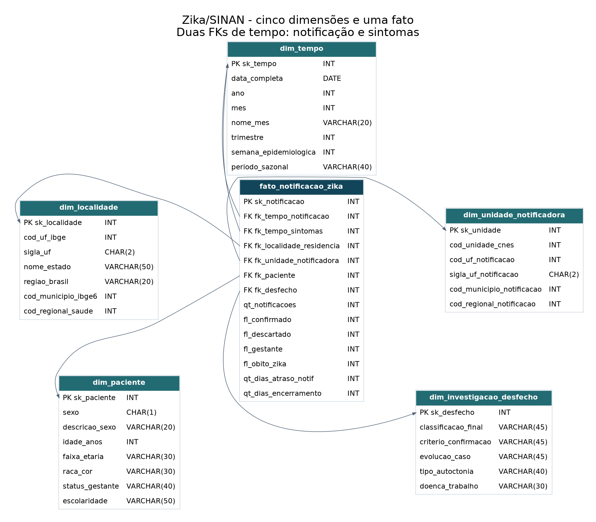

# Dicionário de dados e mapeamento de divergências — Zika/SINAN

Este é o dicionário do projeto, extraído do relatório e consolidado para **ETL e ELT**.
Os nomes físicos são minúsculos no MySQL. Ambos publicam exatamente as mesmas seis tabelas,
com o mesmo [DDL](../sql/01_script_ddl_do_esquema_estrela.sql).
O [contrato executável](../pipelines/contrato.json) centraliza colunas, tipos e domínios.
Os modelos dbt são gerados dele por `python -m pipelines.generate_dbt`.

## 1. Dicionário físico completo do esquema estrela

[Diagrama vetorial](figuras/esquema_estrela.svg) · [Fonte editável](figuras/esquema_estrela.dot) · [Inventário das fontes](../dados/README_DADOS.md).

As tabelas abaixo cobrem **todos os atributos físicos** do contrato. `INT` e `INTEGER` são sinônimos no DDL MySQL. “Aceita NULL” descreve a restrição física, independentemente de o pipeline preencher um rótulo padrão. PKs são implicitamente NOT NULL. As seis FKs da fato são NOT NULL; referências desconhecidas usam membros dimensionais, em vez de FK nula.

### `dim_tempo`

| Atributo | Tipo físico | Restrição | Origem / derivação | Descrição |
|---|---|---|---|---|
| `sk_tempo` | `INT` | PK / NOT NULL | DT_NOTIFIC / DT_SIN_PRI | Data em YYYYMMDD; 0 para membro desconhecido. |
| `data_completa` | `DATE` | Aceita NULL | DT_NOTIFIC / DT_SIN_PRI | Data válida observada; NULL no membro desconhecido. |
| `ano` | `INT` | Aceita NULL | data_completa | Ano civil da data, sem usar NU_ANO. |
| `mes` | `INT` | Aceita NULL | data_completa | Mês de 1 a 12. |
| `nome_mes` | `VARCHAR(20)` | Aceita NULL | data_completa | Nome do mês em português; Não Informado no membro 0. |
| `trimestre` | `INT` | Aceita NULL | data_completa | Trimestre civil de 1 a 4. |
| `semana_epidemiologica` | `INT` | Aceita NULL | data_completa | Semana por regra domingo/sábado e primeira semana com quatro dias; ver seção 2. |
| `periodo_sazonal` | `VARCHAR(40)` | Aceita NULL | data_completa | Rótulo fixo Jan–Mai ou Jun–Dez; convenção do projeto, não resultado estatístico. |

### `dim_localidade`

| Atributo | Tipo físico | Restrição | Origem / derivação | Descrição |
|---|---|---|---|---|
| `sk_localidade` | `INT` | PK / NOT NULL | Combinação da dimensão | Chave substituta; 0 reservado ao desconhecido. |
| `cod_uf_ibge` | `INT` | Aceita NULL | SG_UF | Código numérico de residência; zero/ausente/inválido vira NULL. |
| `sigla_uf` | `CHAR(2)` | NOT NULL | SG_UF + cadastro de UFs | Sigla conhecida ou NI. |
| `nome_estado` | `VARCHAR(50)` | Aceita NULL | SG_UF + cadastro de UFs | Nome conhecido ou Não Informado. |
| `regiao_brasil` | `VARCHAR(20)` | Aceita NULL | SG_UF + cadastro de UFs | Macrorregião conhecida ou Não Informado. |
| `cod_municipio_ibge6` | `INT` | Aceita NULL | ID_MN_RESI | Código de município de residência convertido para inteiro; não valida existência no cadastro municipal. |
| `cod_regional_saude` | `INT` | Aceita NULL | ID_RG_RESI | Código da regional de residência convertido para inteiro; zero/ausente/inválido vira NULL. |

### `dim_unidade_notificadora`

| Atributo | Tipo físico | Restrição | Origem / derivação | Descrição |
|---|---|---|---|---|
| `sk_unidade` | `INT` | PK / NOT NULL | Combinação da dimensão | Chave substituta da combinação de unidade e localização; 0 reservado. |
| `cod_unidade_cnes` | `INT` | Aceita NULL | ID_UNIDADE | Código CNES convertido para inteiro; zero/ausente/inválido vira NULL. |
| `cod_uf_notificacao` | `INT` | Aceita NULL | SG_UF_NOT | Código numérico da UF de notificação. |
| `sigla_uf_notificacao` | `CHAR(2)` | Aceita NULL | SG_UF_NOT + cadastro de UFs | Sigla da UF de notificação conhecida ou NI. |
| `cod_municipio_notificacao` | `INT` | Aceita NULL | ID_MUNICIP | Código inteiro do município de notificação. |
| `cod_regional_notificacao` | `INT` | Aceita NULL | ID_REGIONA | Código inteiro da regional de notificação. |

### `dim_paciente`

| Atributo | Tipo físico | Restrição | Origem / derivação | Descrição |
|---|---|---|---|---|
| `sk_paciente` | `INT` | PK / NOT NULL | Combinação da dimensão | Chave do perfil, não um identificador individual de paciente; 0 reservado. |
| `sexo` | `CHAR(1)` | Aceita NULL | CS_SEXO | M, F ou I; desconhecido vira I. |
| `descricao_sexo` | `VARCHAR(20)` | Aceita NULL | CS_SEXO | Descrição conforme domínio; padrão Ignorado. |
| `idade_anos` | `INT` | Aceita NULL | NU_IDADE_N | 1000–3999 vira 0; 4000–4120 subtrai 4000; demais NULL. |
| `faixa_etaria` | `VARCHAR(30)` | Aceita NULL | idade_anos | 0–14, 15–29, 30–44, 45–59, 60+ ou Ignorado. |
| `raca_cor` | `VARCHAR(30)` | Aceita NULL | CS_RACA | Domínio raça/cor; padrão Ignorado. |
| `status_gestante` | `VARCHAR(40)` | Aceita NULL | CS_GESTANT | Domínio de gestação; padrão Ignorado. |
| `escolaridade` | `VARCHAR(50)` | Aceita NULL | CS_ESCOL_N | Domínio de escolaridade; código 0 preserva Analfabeto. |

### `dim_investigacao_desfecho`

| Atributo | Tipo físico | Restrição | Origem / derivação | Descrição |
|---|---|---|---|---|
| `sk_desfecho` | `INT` | PK / NOT NULL | Combinação da dimensão | Chave substituta da combinação dos atributos de investigação; 0 reservado. |
| `classificacao_final` | `VARCHAR(45)` | Aceita NULL | CLASSI_FIN | Domínio de classificação; padrão Inconclusivo / Em Investigação. |
| `criterio_confirmacao` | `VARCHAR(45)` | Aceita NULL | CRITERIO | Domínio de critério; padrão Ignorado / Não Preenchido. |
| `evolucao_caso` | `VARCHAR(45)` | Aceita NULL | EVOLUCAO | Domínio de evolução; padrão Ignorado / Em Acompanhamento. |
| `tipo_autoctonia` | `VARCHAR(40)` | Aceita NULL | TPAUTOCTO | Domínio de autoctonia; padrão Indeterminado / Ignorado. |
| `doenca_trabalho` | `VARCHAR(30)` | Aceita NULL | DOENCA_TRA | Domínio da relação com trabalho; padrão Ignorado. |

### `fato_notificacao_zika`

| Atributo | Tipo físico | Restrição | Origem / derivação | Descrição |
|---|---|---|---|---|
| `sk_notificacao` | `INT` | PK / NOT NULL | Ordem das linhas válidas distintas | Chave substituta sequencial da fato; não é identificador do SINAN. |
| `fk_tempo_notificacao` | `INT` | FK / NOT NULL | DT_NOTIFIC | FK para dim_tempo.sk_tempo no papel de notificação; data obrigatória válida. |
| `fk_tempo_sintomas` | `INT` | FK / NOT NULL | DT_SIN_PRI | FK para dim_tempo.sk_tempo no papel de sintomas; 0 quando ausente/inválida. |
| `fk_localidade_residencia` | `INT` | FK / NOT NULL | Atributos de residência | FK para dim_localidade.sk_localidade. |
| `fk_unidade_notificadora` | `INT` | FK / NOT NULL | Atributos de notificação | FK para dim_unidade_notificadora.sk_unidade. |
| `fk_paciente` | `INT` | FK / NOT NULL | Perfil sociodemográfico | FK para dim_paciente.sk_paciente; não identifica pessoa. |
| `fk_desfecho` | `INT` | FK / NOT NULL | Atributos de investigação | FK para dim_investigacao_desfecho.sk_desfecho. |
| `qt_notificacoes` | `INT` | NOT NULL | Constante por linha válida | Sempre 1; soma conta linhas da fato. |
| `fl_confirmado` | `INT` | NOT NULL | CLASSI_FIN | 1 se código 1; 0 nos demais casos. |
| `fl_descartado` | `INT` | NOT NULL | CLASSI_FIN | 1 se código 2; 0 nos demais casos. |
| `fl_gestante` | `INT` | NOT NULL | CS_GESTANT | 1 se código 1, 2, 3 ou 4; 0 nos demais. |
| `fl_obito_zika` | `INT` | NOT NULL | EVOLUCAO | 1 somente se código 2; código 3 não entra. |
| `qt_dias_atraso_notif` | `INT` | Aceita NULL | DT_NOTIFIC − DT_SIN_PRI | Diferença de 0 a 365 dias; NULL se ausente/inválida/fora do intervalo. |
| `qt_dias_encerramento` | `INT` | Aceita NULL | DT_ENCERRA − DT_NOTIFIC | Diferença de 0 a 365 dias; NULL se ausente/inválida/fora do intervalo. |

### Restrições e interpretação das medidas

- As seis tabelas usam InnoDB e `utf8mb4_0900_bin`. FKs são aplicadas pelo MySQL, inclusive na publicação transacional.
- `qt_notificacoes` tem DEFAULT 1 e CHECK igual a 1. As quatro flags têm DEFAULT 0 e CHECK de domínio 0/1. A validação operacional também impede confirmação e descarte simultâneos.
- Intervalos têm CHECK de 0 a 365; NULL é permitido. A regra de 365 dias é do projeto, não um prazo normativo de investigação.
- Somas das quantidades e flags contam registros ou subconjuntos de registros. Médias de intervalos desconsideram NULL; publicar o número de observações válidas junto às médias. As contagens não identificam pessoas únicas nem calculam incidência populacional.
- `dim_paciente` e as demais dimensões de perfil representam combinações de atributos, sem controle histórico SCD. As SKs sequenciais são reproduzíveis para a mesma entrada, mas não são identificadores estáveis entre versões diferentes dos dados.
- `dim_tempo` reúne as datas observadas de notificação e sintomas; não é um calendário contínuo. A mesma tabela é referenciada duas vezes pela fato.

## 2. Regras comuns e granularidade

- Uma linha da fato representa uma linha válida distinta do conjunto de **38 campos brutos**.
  Deduplicação exata dentro e entre arquivos, preservando a primeira ocorrência pela ordem arquivo/linha.
  Sem identificador único na fonte, não se presume que linhas diferentes sejam o mesmo caso.
- Os três CSVs usam UTF-8 (BOM tolerado), vírgula e o mesmo cabeçalho de 38 campos.
  ELT armazena todo o texto em `stg_zika` antes de qualquer limpeza, com `arquivo_origem`
  e `linha_origem`. ETL lê o mesmo texto em Pandas e transforma em memória.
- `DT_NOTIFIC` deve ser uma data ISO válida (`YYYY-MM-DD`, anos 1000–9999).
  Ausência ou data impossível causa quarentena. ETL exporta `saidas/etl/rejeitados.csv`;
  ELT mantém `elt_rejeitados` no MySQL. As datas opcionais inválidas tornam-se NULL.
- Ano, mês e trimestre vêm da data efetiva; `NU_ANO` e o nome do arquivo não definem o calendário.
  `SEM_NOT`/`SEM_PRI` são preservados no staging; `dim_tempo` usa semana de domingo a sábado,
  primeira semana com ao menos quatro dias do ano (MySQL `WEEK(data,6)`).
- Idade: `1000 <= NU_IDADE_N < 4000` vira 0 anos; de 4000 a 4120 subtrai-se 4000;
  qualquer outro código vira NULL. As faixas são **0 a 14**, **15 a 29**, **30 a 44**,
  **45 a 59**, **60 anos ou mais** e **Ignorado**.
- Códigos textuais não negativos com até nove dígitos, inclusive sufixo decimal composto só de zeros (como `.0`), são convertidos para inteiro após remover espaços nas extremidades.
  Zero em códigos geográficos vira NULL; `CS_ESCOL_N=0` permanece **Analfabeto**.
- A residência ausente permanece desconhecida, sem inferência a partir do local de atendimento.
  UF sem cadastro recebe `NI` / `Não Informado`; códigos numéricos válidos são preservados.
- Intervalos entre sintomas/notificação e notificação/encerramento são aceitos entre 0 e 365 dias,
  inclusive. Valores negativos, acima de 365 ou com datas ausentes viram NULL.
- `qt_notificacoes=1`; `fl_confirmado=(CLASSI_FIN=1)`, `fl_descartado=(CLASSI_FIN=2)`,
  `fl_gestante=(CS_GESTANT em 1,2,3,4)` e `fl_obito_zika=(EVOLUCAO=2)`.
  Óbitos por outras causas (`EVOLUCAO=3`) não compõem `fl_obito_zika`.
- Dimensões de perfil são combinações distintas de atributos, não pessoas identificadas.
  As SKs de perfil são determinísticas para a mesma entrada, sequenciais a partir de 1; tempo usa YYYYMMDD. Não há garantia de estabilidade das SKs entre extrações diferentes.
  Todas as dimensões contêm SK=0 reservado ao membro desconhecido. Datas ausentes referenciam 0.
  Combinações parcialmente desconhecidas conservam seus atributos e recebem SK própria.
- MySQL 8.0.16+, InnoDB, `utf8mb4_0900_bin`; FKs explícitas e checks no DDL comum.
  A publicação substitui os dados das seis tabelas em transação; falha causa rollback.
  Não execute os dois pipelines simultaneamente no mesmo banco.

## 3. Domínios de decodificação

Códigos não listados, vazios ou inválidos usam o padrão da coluna.

### `descricao_sexo` ← `CS_SEXO`

| Código | Descrição |
|---|---|
| `M` | Masculino |
| `F` | Feminino |
| `I` | Ignorado |

**Padrão:** Ignorado.

### `raca_cor` ← `CS_RACA`

| Código | Descrição |
|---|---|
| `1` | Branca |
| `2` | Preta |
| `3` | Amarela |
| `4` | Parda |
| `5` | Indígena |
| `9` | Ignorado |

**Padrão:** Ignorado.

### `status_gestante` ← `CS_GESTANT`

| Código | Descrição |
|---|---|
| `1` | 1º Trimestre |
| `2` | 2º Trimestre |
| `3` | 3º Trimestre |
| `4` | Idade Gestacional Ignorada |
| `5` | Não Gestante |
| `6` | Não se aplica |
| `9` | Ignorado |

**Padrão:** Ignorado.

### `escolaridade` ← `CS_ESCOL_N`

| Código | Descrição |
|---|---|
| `0` | Analfabeto |
| `1` | 1ª a 4ª série incompleta |
| `2` | 4ª série completa |
| `3` | 5ª à 8ª série incompleta |
| `4` | Ensino fundamental completo |
| `5` | Ensino médio incompleto |
| `6` | Ensino médio completo |
| `7` | Educação superior incompleta |
| `8` | Educação superior completa |
| `9` | Ignorado |
| `10` | Não se aplica |

**Padrão:** Ignorado.

### `classificacao_final` ← `CLASSI_FIN`

| Código | Descrição |
|---|---|
| `1` | Confirmado |
| `2` | Descartado |
| `8` | Inconclusivo / Em Investigação |

**Padrão:** Inconclusivo / Em Investigação.

### `criterio_confirmacao` ← `CRITERIO`

| Código | Descrição |
|---|---|
| `1` | Laboratorial |
| `2` | Clínico-Epidemiológico |
| `3` | Em Investigação |

**Padrão:** Ignorado / Não Preenchido.

### `evolucao_caso` ← `EVOLUCAO`

| Código | Descrição |
|---|---|
| `1` | Cura |
| `2` | Óbito pelo agravo |
| `3` | Óbito por outras causas |

**Padrão:** Ignorado / Em Acompanhamento.

### `tipo_autoctonia` ← `TPAUTOCTO`

| Código | Descrição |
|---|---|
| `1` | Autóctone |
| `2` | Importado |

**Padrão:** Indeterminado / Ignorado.

### `doenca_trabalho` ← `DOENCA_TRA`

| Código | Descrição |
|---|---|
| `1` | Sim |
| `2` | Não |

**Padrão:** Ignorado.

## 4. Cadastro de UFs

| Código IBGE | Sigla | Estado | Região |
|---|---|---|---|
| 11 | RO | Rondônia | Norte |
| 12 | AC | Acre | Norte |
| 13 | AM | Amazonas | Norte |
| 14 | RR | Roraima | Norte |
| 15 | PA | Pará | Norte |
| 16 | AP | Amapá | Norte |
| 17 | TO | Tocantins | Norte |
| 21 | MA | Maranhão | Nordeste |
| 22 | PI | Piauí | Nordeste |
| 23 | CE | Ceará | Nordeste |
| 24 | RN | Rio Grande do Norte | Nordeste |
| 25 | PB | Paraíba | Nordeste |
| 26 | PE | Pernambuco | Nordeste |
| 27 | AL | Alagoas | Nordeste |
| 28 | SE | Sergipe | Nordeste |
| 29 | BA | Bahia | Nordeste |
| 31 | MG | Minas Gerais | Sudeste |
| 32 | ES | Espírito Santo | Sudeste |
| 33 | RJ | Rio de Janeiro | Sudeste |
| 35 | SP | São Paulo | Sudeste |
| 41 | PR | Paraná | Sul |
| 42 | SC | Santa Catarina | Sul |
| 43 | RS | Rio Grande do Sul | Sul |
| 50 | MS | Mato Grosso do Sul | Centro-Oeste |
| 51 | MT | Mato Grosso | Centro-Oeste |
| 52 | GO | Goiás | Centro-Oeste |
| 53 | DF | Distrito Federal | Centro-Oeste |

## 5. Divergências entre os arquivos e destino dos campos

| Divergência | Tratamento efetivo nos pipelines |
|---|---|
| Ano do arquivo, `NU_ANO` e `DT_NOTIFIC` podem divergir | Calendário derivado de `DT_NOTIFIC`; deduplicação exata interanual. |
| Códigos vazios, zeros e representação decimal | Conversão comum e padrões dos domínios; preserva escolaridade 0. |
| Maior ausência de desfecho em extrações recentes | Mantém notificações e usa os rótulos de investigação definidos acima. |
| Idade composta e valores acima de 120 anos | Decodificação e NULL conforme seção 2. |
| Datas de sintomas ou encerramento incoerentes | Intervalos fora de 0–365 viram NULL. |
| `ID_AGRAVO` como `A92.` e `A928`; `COUFINF` misto (ex.: `ES`) | Preservados no bruto; não são atributos do esquema estrela atual. Não há limpeza dessas colunas na fato. |

Campos usados nas dimensões: `DT_NOTIFIC`, `DT_SIN_PRI`, `SG_UF`, `ID_MN_RESI`, `ID_RG_RESI`,
`ID_UNIDADE`, `SG_UF_NOT`, `ID_MUNICIP`, `ID_REGIONA`, `CS_SEXO`, `NU_IDADE_N`, `CS_RACA`,
`CS_GESTANT`, `CS_ESCOL_N`, `CLASSI_FIN`, `CRITERIO`, `EVOLUCAO`, `TPAUTOCTO`, `DOENCA_TRA`.
`DT_ENCERRA` alimenta a métrica de encerramento. Os demais campos não são promovidos para a estrela;
permanecem nos CSVs e, no ELT, no staging. Não são criadas flags ou dimensões extras.

Na entrada versionada: 82.460 linhas brutas, 56 duplicatas exatas, 0 rejeições e 82.404 linhas na fato.
Esses totais são evidências desta versão, não constantes exigidas para novas extrações.

## 6. Rastreabilidade dos 38 campos brutos

Todos os campos abaixo participam da deduplicação exata e permanecem nos CSVs e no staging ELT. O destino indica o uso analítico atual; não implica que outros campos sejam apagados da fonte. A fato final não conserva arquivo/linha de origem: esses metadados permanecem na ingestão, no staging ELT e nas rejeições disponíveis.

| Campo bruto | Destino no contrato atual |
|---|---|
| `TP_NOT` | Sem promoção à estrela; preservado na fonte/staging e na comparação bruta |
| `ID_AGRAVO` | Sem promoção à estrela; preservado na fonte/staging e na comparação bruta |
| `DT_NOTIFIC` | dim_tempo (papel notificação), calendário e métricas da fato |
| `SEM_NOT` | Sem promoção à estrela; preservado na fonte/staging e na comparação bruta |
| `NU_ANO` | Sem promoção à estrela; preservado na fonte/staging e na comparação bruta |
| `SG_UF_NOT` | dim_unidade_notificadora |
| `ID_MUNICIP` | dim_unidade_notificadora |
| `ID_REGIONA` | dim_unidade_notificadora |
| `ID_UNIDADE` | dim_unidade_notificadora |
| `DT_SIN_PRI` | dim_tempo (papel sintomas) e atraso de notificação |
| `SEM_PRI` | Sem promoção à estrela; preservado na fonte/staging e na comparação bruta |
| `ANO_NASC` | Sem promoção à estrela; preservado na fonte/staging e na comparação bruta |
| `NU_IDADE_N` | dim_paciente.idade_anos / faixa_etaria |
| `CS_SEXO` | dim_paciente.sexo / descricao_sexo |
| `CS_GESTANT` | dim_paciente.status_gestante e fato.fl_gestante |
| `CS_RACA` | dim_paciente.raca_cor |
| `CS_ESCOL_N` | dim_paciente.escolaridade |
| `SG_UF` | dim_localidade e cadastro de UFs |
| `ID_MN_RESI` | dim_localidade.cod_municipio_ibge6 |
| `ID_RG_RESI` | dim_localidade.cod_regional_saude |
| `ID_PAIS` | Sem promoção à estrela; preservado na fonte/staging e na comparação bruta |
| `NDUPLIC_N` | Sem promoção à estrela; preservado na fonte/staging e na comparação bruta |
| `IN_VINCULA` | Sem promoção à estrela; preservado na fonte/staging e na comparação bruta |
| `DT_INVEST` | Sem promoção à estrela; preservado na fonte/staging e na comparação bruta |
| `ID_OCUPA_N` | Sem promoção à estrela; preservado na fonte/staging e na comparação bruta |
| `CLASSI_FIN` | dim_investigacao_desfecho.classificacao_final e flags confirmado/descartado |
| `CRITERIO` | dim_investigacao_desfecho.criterio_confirmacao |
| `TPAUTOCTO` | dim_investigacao_desfecho.tipo_autoctonia |
| `COUFINF` | Sem promoção à estrela; preservado na fonte/staging e na comparação bruta |
| `COPAISINF` | Sem promoção à estrela; preservado na fonte/staging e na comparação bruta |
| `COMUNINF` | Sem promoção à estrela; preservado na fonte/staging e na comparação bruta |
| `DOENCA_TRA` | dim_investigacao_desfecho.doenca_trabalho |
| `EVOLUCAO` | dim_investigacao_desfecho.evolucao_caso e fato.fl_obito_zika |
| `DT_OBITO` | Sem promoção à estrela; preservado na fonte/staging e na comparação bruta |
| `DT_ENCERRA` | fato.qt_dias_encerramento |
| `DT_DIGITA` | Sem promoção à estrela; preservado na fonte/staging e na comparação bruta |
| `TP_SISTEMA` | Sem promoção à estrela; preservado na fonte/staging e na comparação bruta |
| `TPUNINOT` | Sem promoção à estrela; preservado na fonte/staging e na comparação bruta |
