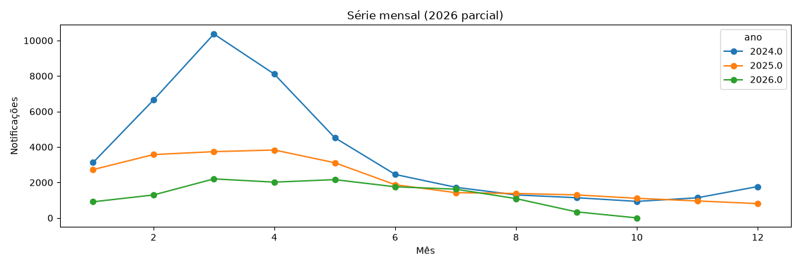

# Universidade Federal de Pernambuco
## Centro de Informática - CIn

**Integrantes (Nome - login):**
* Cauã Emanuel - `ceor@cin.ufpe.br`
* Allanis Beatriz - `aboml@cin.ufpe.br`
* Arthur Gabriel - `agsl@cin.ufpe.br`
* Allan Fernandes - `afl4@cin.ufpe.br`
* Felipe Melo - `fma4@cin.ufpe.br`
* Amanda Pereira - `apmo@cin.ufpe.br`

**TEMA:** Integração e Análise Dimensional das Notificações de Zika Vírus no Brasil no Triênio 2024–2026 (SINAN / Ministério da Saúde)

---

# Relatório do Projeto de Integração — Banco de Dados — 2026.2

---

## 1. Descrição da Base de Dados Unificada (Modelagem Dimensional e Dicionário de Dados)

O projeto integra três extrações de notificações de Zika do SINAN, identificadas como 2024, 2025 e 2026. A fonte temática declarada é o [portal do Ministério da Saúde](https://dadosabertos.saude.gov.br/dataset/arboviroses-zika-virus), consultado em 16/11/2026. A data original de download, os endereços diretos dos recursos e eventuais conversões anteriores aos CSVs não foram registrados. A reprodução desta entrega usa os arquivos preservados no repositório, identificados por hashes SHA-256 no [inventário das fontes](../dados/metadados_fontes.json).

| Extração | Linhas brutas | Colunas | Intervalo observado de DT_NOTIFIC |
|---|---:|---:|---|
| `ZIKABR24.csv` | 43.312 | 38 | 01/01/2024 a 24/02/2025 |
| `ZIKABR25.csv` | 25.764 | 38 | 29/12/2024 a 12/02/2026 |
| `ZIKABR26.csv` | 13.384 | 38 | 04/01/2026 a 05/10/2026 |
| **Total bruto** | **82.460** | **38 campos comuns** | **2026 parcial** |

O cabeçalho é igual nos três arquivos. O ano da data pode diferir do ano indicado no nome: 69 linhas no arquivo de 2024 e 12 no de 2025 apresentam essa situação. Esses dados são preservados e o calendário analítico usa `DT_NOTIFIC`. Os limites de datas não comprovam completude dos períodos. A [documentação das fontes](../dados/README_DADOS.md) detalha o inventário e suas limitações.

### 1.1. Arquitetura do esquema estrela

O Data Warehouse possui uma tabela fato e cinco dimensões, compartilhadas pelos pipelines ETL e ELT. Os nomes físicos no MySQL são minúsculos.

*Figura 1 — Estrutura física comum aos dois fluxos. As setas saem das FKs da fato para as PKs das dimensões. Fonte: contrato e DDL do projeto. [Versão vetorial](figuras/esquema_estrela.svg) e [fonte editável Graphviz](figuras/esquema_estrela.dot).*

| Tabela | Papel |
|---|---|
| `fato_notificacao_zika` | Registro integrado e suas métricas; referencia os seis papéis dimensionais por FK. |
| `dim_tempo` | Calendário compartilhado por duas FKs: data da notificação e data dos primeiros sintomas. Não são duas tabelas diferentes. |
| `dim_localidade` | UF, município e regional de residência; permite distinguir residência de atendimento. |
| `dim_unidade_notificadora` | Unidade CNES e localização da notificação. |
| `dim_paciente` | Combinação de atributos sociodemográficos e gestacionais, sem identificação de pessoa. |
| `dim_investigacao_desfecho` | Combinação de classificação, critério, evolução, autoctonia e doença relacionada ao trabalho. |

### 1.2. Granularidade, chaves e medidas

Uma linha da fato representa **uma linha válida distinta nos 38 valores textuais originais**. A deduplicação exata preserva a primeira ocorrência na ordem arquivo/linha. Registros com qualquer diferença de conteúdo permanecem distintos; não se infere identidade de caso ou de pessoa. Mesmo que duas linhas brutas diferentes resultem nos mesmos atributos analíticos, ambas permanecem na fato.

A chave `sk_notificacao` é substituta, não um identificador fornecido pelo SINAN. As dimensões de perfil recebem chaves sequenciais pela ordenação das combinações; `dim_tempo` usa YYYYMMDD. A estabilidade dessas chaves refere-se à mesma entrada e às mesmas regras: elas podem mudar em outra carga. Há um membro desconhecido SK=0 em cada dimensão; sintomas sem data usam essa referência, enquanto combinações de perfil desconhecidas são materializadas com suas próprias SKs.

`qt_notificacoes=1` permite somar registros. As flags de confirmação, descarte, gestação e óbito pelo agravo permitem somas por recorte. Os intervalos de notificação e encerramento são métricas anuláveis: médias usam apenas os valores válidos, devendo ser acompanhadas da quantidade de observações. Nenhuma dessas medidas representa incidência sem denominador populacional.

As seis tabelas usam InnoDB, `utf8mb4_0900_bin`, PKs e seis FKs físicas. O DDL restringe flags a 0/1, quantidade a 1 e intervalos não nulos a 0–365 dias. A publicação carrega dimensões antes da fato e substitui seus conteúdos em uma transação; uma falha provoca rollback. O calendário é formado pelas datas observadas de notificação e sintomas, não por todos os dias de um intervalo contínuo.

### 1.3. Dicionário de dados

O [dicionário completo](dicionario_de_dados_e_mapeamento_de_divergencias.md) integra a documentação do relatório e contém os atributos das seis tabelas, tipos com comprimentos, nulabilidade, origem e regras de cálculo. Ele deve acompanhar qualquer exportação do relatório como anexo ou arquivo vinculado. O [contrato executável](../pipelines/contrato.json) e o [DDL compartilhado](../sql/01_script_ddl_do_esquema_estrela.sql) são as referências físicas para reprodução.

---

## 2. Explicação Detalhada do Processo de Integração

### 2.1. ETL: transformar antes de carregar

O notebook `pipeline_ETL.ipynb` chama `extract()` para ler os três CSVs como texto, preservando os 38 campos e acrescentando `arquivo_origem` e `linha_origem`. `transform()` remove somente duplicatas exatas, valida datas e decodifica os domínios. `star()` constrói as cinco dimensões e as chaves da fato em memória. Somente depois dessas etapas `publish()` abre a publicação MySQL, prepara o DDL e insere dimensões antes da fato. `validate()` consulta contagens e métricas finais.

A [cópia executada em Colab](evidencias/etl_colab_executado.ipynb) já incluída pela equipe mostra **82.460 linhas lidas, 56 duplicatas, zero rejeições e 82.404 linhas finais**, com as cinco dimensões consultadas no MySQL. O [manifesto ETL](evidencias/manifesto_etl.json) registra 31,061 segundos para a execução CLI. Essa evidência usa Python 3.13 com dependências apenas do ETL; não demonstra compatibilidade do dbt nesse runtime. Para reproduzir ambos os fluxos, seguir a faixa Python 3.10–3.12 documentada no README.

### 2.2. ELT: transformar dentro do MySQL

O notebook ELT lê os CSVs como texto e chama `load_raw()` para gravar **82.460 linhas brutas** em `stg_zika`, com metadados de origem. `stg_zika_unica` deduplica os 38 campos; `int_zika_tipificada` valida tipos e datas; `int_zika_decodificada` traduz domínios e calcula indicadores/intervalos; `int_zika` acrescenta a faixa etária. `elt_rejeitados` preserva linhas cuja data obrigatória é inválida. Os modelos `elt_dim_*` e `elt_fato_notificacao_zika` constroem a estrela por SQL, ordenados pelas dependências `source()` e `ref()` do dbt.

O comando `dbt build` constrói e testa os modelos. Após seu sucesso, `publish()` copia as tabelas ELT para a estrela final com `INSERT ... SELECT`, dentro de uma transação. O [notebook ELT](../notebooks/pipeline_ELT_completo_executado.ipynb) e os [SQLs completos](../dbt/models/) fazem parte da entrega. Apesar do nome histórico, o notebook-fonte está sem saídas: **a evidência de execução ELT em Colab continua pendente**. A [validação MySQL de 13/11](validacao_pipelines.md) é evidência histórica local, não execução Colab.

### 2.3. Etapas intermediárias e resultado comum

| Etapa | Registros |
|---|---:|
| Extração / staging bruto | 82.460 |
| Após remover 56 duplicatas exatas | 82.404 |
| Rejeitados pela data obrigatória | 0 |
| Fato publicada na evidência ETL | 82.404 |

Dimensões, incluindo SK=0: tempo **1.003**, localidade **2.562**, unidade notificadora **6.631**, paciente **9.024** e investigação/desfecho **128**. A revisão de 18/11 reconstruiu a estrela em memória e confirmou essas contagens; não repetiu a publicação MySQL, pois não havia servidor disponível neste ambiente.

---

## 3. Justificativa da Escolha da Base de Dados

A base de Zika foi escolhida por reunir notificações de um mesmo tema em três extrações anuais consecutivas e permitir relacionar tempo, residência, atendimento, perfil do paciente e investigação. O [Ministério da Saúde](https://dadosabertos.saude.gov.br/dataset/arboviroses-zika-virus) descreve o SINAN como um sistema de suporte à investigação e à análise da vigilância epidemiológica. No projeto, os campos de gestação e desfecho permitem formular perguntas sobre notificações em gestantes e sua classificação, dentro dos limites da informação disponível.

A estrutura comum de 38 campos facilita a integração sem eliminar os desafios de qualidade. A auditoria encontrou diferenças entre o ano do arquivo e o ano da data de notificação, duplicatas exatas e preenchimento desigual de campos de investigação. Por exemplo, `CLASSI_FIN` está vazio em 537, 433 e 754 registros nos arquivos de 2024, 2025 e 2026, respectivamente. A comparação deve considerar também os tamanhos das extrações. Esses fatos estão registrados no [inventário reprodutível](../dados/metadados_fontes.json).

Do ponto de vista técnico, a escolha permite demonstrar: (a) decodificação de idade composta e domínios; (b) calendário derivado da data efetiva; (c) deduplicação entre e dentro dos arquivos; (d) construção de chaves e dimensões; e (e) tratamento de desconhecidos e intervalos inválidos. Aplicar o mesmo contrato em Python e no MySQL permite comparar ETL e ELT sem atribuir à ordem de processamento diferenças provocadas por regras de negócio incompatíveis.

A organização dimensional dá suporte às três perguntas analíticas do projeto: evolução mensal das notificações; notificações e confirmações em gestantes por UF de residência; e tempos até notificação e encerramento por região. A modelagem foi escolhida para tornar esses cruzamentos explícitos, sem afirmar ganho de desempenho não medido.

Os resultados descrevem a versão local das notificações. O arquivo de 2026 é parcial; investigações podem estar incompletas; não há denominadores populacionais ou identificador único de pessoa/caso na extração. Por isso, o projeto não estima incidência, risco individual, causalidade ou transmissão a partir apenas das contagens, nem considera reduções de contagem como evidência automática de melhora epidemiológica.

---

## 4. Descrição dos Processos de Transformação Aplicados

Os dois fluxos implementam o mesmo [contrato](../pipelines/contrato.json). No ETL, `extract`, `transform` e `star` em [pipelines/core.py](../pipelines/core.py) leem o texto, transformam os registros e constroem as dimensões em memória antes da carga. No ELT, o texto é carregado em `stg_zika`, com `arquivo_origem` e `linha_origem`; os [modelos SQL dbt](../dbt/models/) fazem a transformação no MySQL. A publicação de ambos usa o mesmo DDL.

### 4.1. Regras aplicadas e exemplos

| Etapa | Regra efetiva | Exemplo de entrada → saída |
|---|---|---|
| Leitura | Preservar valores textuais dos 38 campos e acrescentar arquivo/linha de origem | Linha 2 de `ZIKABR24.csv` → metadados de origem na ingestão |
| Deduplicação | Comparar os 38 textos antes de qualquer conversão, preservando a primeira ocorrência | Duas linhas idênticas em qualquer arquivo → um registro; `26` e `26.0` são diferentes na comparação bruta |
| Data obrigatória | Remover espaços e validar `DT_NOTIFIC` em YYYY-MM-DD; anos 1000–9999 | `2024-02-30` → quarentena, sem publicação na fato |
| Datas opcionais | Datas impossíveis/ausentes de sintomas e encerramento tornam-se NULL | Sintomas ausentes → `fk_tempo_sintomas=0` e atraso NULL |
| Calendário | Usar a data de notificação, não o ano do arquivo ou `NU_ANO` | Data `2025-01-02` em arquivo de 2024 → ano analítico 2025 |
| Códigos | Converter inteiros textuais e representações com parte decimal zero | `26.0` → 26; escolaridade `0` → Analfabeto |
| Geografia | Mapear UFs pelo contrato, sem inferir residência pelo atendimento | `SG_UF=26` → PE/Pernambuco/Nordeste; residência vazia → NI/Não Informado |
| Idade | Códigos 1000–3999 → 0 anos; 4000–4120 → código menos 4000; demais → NULL | `4030.0` → 30 anos / 30 a 44 anos; `4121` → NULL / Ignorado |
| Domínios | Decodificar sexo, raça/cor, gestação, escolaridade e investigação; usar padrão em valores desconhecidos | `CS_GESTANT=4` → Idade Gestacional Ignorada; `fl_gestante=1` |
| Indicadores | Confirmação: `CLASSI_FIN=1`; descarte: `=2`; gestação: códigos 1–4; óbito pelo agravo: `EVOLUCAO=2` | `EVOLUCAO=3` → Óbito por outras causas; `fl_obito_zika=0` |
| Intervalos | Calcular diferença de datas; manter 0–365 dias e converter demais intervalos em NULL | Sintomas posteriores à notificação → atraso NULL, preservando a notificação |
| Chaves | Gerar dimensões por combinações distintas e publicar suas PKs na fato | Duas datas de uma notificação → duas FKs para `dim_tempo` |

Os exemplos ilustram o contrato e não são apresentados como transcrições de linhas reais dos CSVs. As faixas de idade são 0–14, 15–29, 30–44, 45–59, 60+ e Ignorado. A semana é calculada com início no domingo e primeira semana com pelo menos quatro dias do ano, conforme a regra comum implementada. Os rótulos de sazonalidade Jan–Mai/Jun–Dez são uma classificação fixa do projeto, não uma conclusão demonstrada pelos gráficos.

`ID_AGRAVO` e `COUFINF` participam da comparação bruta para deduplicação e permanecem nos CSVs e no staging ELT; não são atributos promovidos à estrela. O código atual não executa a limpeza dessas colunas descrita no PDF comparativo histórico. O detalhamento de todos os campos usados e não usados consta no dicionário.

### 4.2. Reconciliação, publicação e limites

Na versão auditada, **82.460 brutas = 56 duplicatas exatas + 0 rejeições por data de notificação + 82.404 válidas**. As duplicatas são removidas dentro do conjunto consolidado, inclusive quando pertencem ao mesmo arquivo. O limite de 365 dias é uma regra de qualidade do projeto; não equivale a prazo clínico ou normativo de encerramento.

Campos desconhecidos usam NULL ou os padrões documentados, preservando o registro quando a data obrigatória é válida. Intervalos inválidos não excluem notificações. As dimensões são publicadas antes da fato e a integridade é aplicada pelas FKs do MySQL; a troca dos conteúdos finais é transacional. O ELT mantém staging e modelos intermediários, enquanto o ETL transforma antes da conexão de publicação.

Os seis testes Python foram aprovados em 16/11/2026, incluindo reconciliação, regras de borda e correspondência contrato/DDL/modelos. A validação MySQL de 13/11 está documentada em [validação dos pipelines](validacao_pipelines.md); ela não substitui as evidências da execução Colab que acompanham a entrega. As análises devem usar essa mesma versão deduplicada e explicitar o recorte parcial de 2026.

---

## 5. Comparativo entre ETL e ELT

Os fluxos aplicam as mesmas regras aos mesmos arquivos e publicam o mesmo esquema. A diferença está no local e na ordem da transformação, não em critérios distintos de limpeza.

| Critério | ETL | ELT |
|---|---|---|
| Ordem | Extrair → transformar em Python → carregar estrela | Extrair → carregar staging → transformar em SQL → publicar estrela |
| Ferramentas | Pandas e funções Python | MySQL e modelos dbt com dependências explícitas |
| Vantagem no projeto | Inspeção de registros e depuração das regras antes da carga | Texto bruto consultável no staging e transformação/testes declarados no banco |
| Custo / limitação | DataFrames, registros e dimensões ocupam memória do processo Python | Staging e tabelas intermediárias ocupam armazenamento e recursos do SGBD; exige adapter dbt compatível |
| Deduplicação | `drop_duplicates` sobre 38 campos | Agrupamento dos 38 campos e ordenação por origem |
| Reprocessamento demonstrado | Comando completo relê CSVs e reconstrói a estrela | Comando completo relê CSVs, recarrega staging e executa dbt |
| Publicação | Inserção em lotes por connector | `INSERT ... SELECT` dos modelos ELT |
| Integridade | Mesmo DDL com PK/FK/checks e rollback | Mesmo DDL com PK/FK/checks e rollback |
| Medição disponível | 31,061 s na evidência Colab ETL | Sem medição Colab comparável disponível |

O tempo ETL é uma execução de `pipelines.run.run('etl')`, incluindo leitura, transformação, construção da estrela, carga e validação, sem a instalação do ambiente. Não é um benchmark: não há repetições, medição de memória nem tempo ELT equivalente. O tempo isolado do dbt também não seria diretamente comparável ao ETL completo.

Para os 82.460 registros, o ETL facilita inspecionar regras em Python; o ELT demonstra processamento no SGBD e mantém staging auditável. A escolha depende do ambiente, dos recursos e da manutenção desejada. Não se conclui superioridade de desempenho sem medições comparáveis. A equivalência integral das seis tabelas está relatada na validação histórica MySQL, enquanto os testes atuais confirmam contrato, regras e contagens ETL.

---

## 6. Apresentação de Três Análises e Insights

As consultas completas estão no [notebook de análises](../notebooks/analises_zika.ipynb). Nesta revisão, `python -m scripts.validar_analises` reconstruiu a estrela ETL e executou as mesmas seis consultas em SQLite em memória, exportando as [tabelas](analises/tabelas/) e figuras. O [manifesto da revisão](evidencias/validacao_analises.json) identifica hashes, ambiente e contagens. Essa reprodução valida os números; não substitui a execução MySQL/Colab exigida para os pipelines.

### 6.1. Em quais meses se concentram as notificações?

**Método:** somar `qt_notificacoes` por ano e mês de `DT_NOTIFIC`; comparar janeiro–setembro entre anos. [Tabela mensal](analises/tabelas/01_sazonalidade.csv).

**Resultado:** 58.307 de 82.404 notificações (**70,8%**) estão entre janeiro e maio. O pico de 2024 é março, com **10.366** registros; em 2025, abril tem **3.829**. Na janela janeiro–setembro são **39.373**, **22.942** e **13.384** registros em 2024, 2025 e 2026, respectivamente: reduções de aproximadamente **41,7%** em cada comparação sucessiva.

**Insight e limite:** há concentração no início do ano nesta extração, útil para descrever a demanda registrada. Usar meses comuns evita comparar um ano inteiro com um parcial, mas não garante completude dos registros. As contagens não demonstram redução de incidência nem explicação climática causal. Outubro de 2026 contém apenas um registro; não deve ser tratado como mês completo.

### 6.2. Onde se concentram notificações e confirmações em gestantes?

**Método:** somar `fl_gestante` e `fl_gestante * fl_confirmado` por UF de residência, preservando NI. [Tabela por UF](analises/tabelas/02_gestantes.csv).

**Resultado:** **7.184** notificações em gestantes, das quais **207 (2,88%)** confirmadas. SP tem **2.487** notificações e **3** confirmações; MT tem **328** e **109**, respectivamente. MT reúne **52,7%** das confirmações em gestantes. Há **2** notificações com UF não informada, sendo **1** confirmada.

**Insight e limite:** a UF com maior volume de notificações em gestantes não coincide com a maior concentração de confirmações. A comparação pede investigação da cobertura e dos critérios registrados; não permite atribuir diferenças a protocolos de pré-natal ou surtos. São notificações, não contagem de pessoas únicas nem risco de infecção.

### 6.3. Como variam os tempos da vigilância entre regiões?

**Método:** calcular médias somente dos intervalos válidos de 0–365 dias, com contagem e cobertura por métrica. [Tabela com denominadores](analises/tabelas/03_tempos.csv).

| Região | Notificação: média em dias | Encerramento: média em dias | Encerramentos válidos / notificações |
|---|---:|---:|---:|
| Centro-Oeste | 4,49 | 30,34 | 17.410 / 17.513 |
| Nordeste | 5,85 | 29,57 | 32.559 / 33.800 |
| Norte | 6,05 | 23,37 | 15.045 / 15.325 |
| Sudeste | 5,94 | 32,55 | 14.369 / 14.635 |
| Sul | 10,13 | 25,64 | 1.073 / 1.099 |
| Não informado | 5,69 | 14,60 | 25 / 32 |

**Resultado:** no total, o atraso médio de notificação é **5,67 dias**, com mediana **3** e **82.404** intervalos válidos (100%). O encerramento médio é **29,05 dias**, com mediana **19** e **80.481** intervalos válidos (**97,67%**). A média nacional é calculada sobre os registros, não pela média simples das regiões.

**Insight e limite:** o Sul apresenta maior média até notificação, enquanto o Sudeste apresenta maior média até encerramento. O resultado sugere pontos para investigação operacional, sem provar a causa nem medir sozinho a eficiência da vigilância. Os **1.923** intervalos de encerramento ausentes ou inválidos ficam fora da média; a falta de encerramento pode produzir viés.

O notebook preserva três análises complementares de perfil, classificação/critério e diferença entre local de notificação e residência. Elas não são necessárias para atingir as três análises exigidas; seus resultados completos acompanham os CSVs exportados.

---

## 7. Reflexão sobre o Aprendizado

O desenvolvimento do projeto proporcionou uma experiência prática de integração e análise de dados reais, permitindo aplicar conhecimentos adquiridos na disciplina de Banco de Dados em um contexto de saúde pública.
Uma das principais lições aprendidas foi compreender que a integração de dados envolve desafios que ultrapassam a simples união de diferentes arquivos.
Embora os três conjuntos de notificações apresentassem uma estrutura comum de 38 atributos, foi necessário investigar a qualidade dos registros, identificar inconsistências temporais, tratar valores desconhecidos e estabelecer critérios de deduplicação.
A presença de registros associados a anos diferentes daqueles indicados nos nomes dos arquivos demonstrou a importância de definir corretamente os atributos utilizados para representar o tempo nas análises.

Outro aprendizado relevante esteve relacionado à interpretação das variáveis epidemiológicas. Campos como `NU_IDADE_N`, `CS_GESTANT`, `CLASSI_FIN` e `EVOLUCAO` exigiram a compreensão de seus respectivos domínios e regras específicas antes de serem utilizados na construção do Data Warehouse.
Essa etapa evidenciou que a transformação de dados precisa considerar o significado dos atributos, e não apenas seu formato técnico.

A implementação do esquema estrela também contribuiu para aprofundar o entendimento sobre modelagem dimensional, granularidade, chaves substitutas, chaves estrangeiras e organização de tabelas fato e dimensão.
A necessidade de construir dimensões a partir de combinações distintas de atributos permitiu perceber a importância de diferenciar entidades individuais de perfis analíticos, evitando interpretações incorretas dos registros.

A utilização de duas arquiteturas de integração, ETL e ELT, constituiu outro ponto importante do aprendizado.
O desenvolvimento do ETL permitiu explorar a flexibilidade do Python e do Pandas para executar operações de transformação em memória, enquanto o ELT demonstrou como o MySQL e o dbt podem ser utilizados para organizar o processamento diretamente no banco.

A aplicação de um contrato compartilhado entre os dois pipelines reforçou a importância de manter regras de negócio centralizadas e consistentes.

Além disso, os testes de equivalência evidenciaram o valor da validação automatizada. A comparação dos resultados finais permitiu verificar que diferentes implementações podiam produzir a mesma estrutura analítica, enquanto os testes de integridade contribuíram para identificar possíveis falhas de processamento.

Entre os desafios técnicos, destacaram-se a interpretação de códigos epidemiológicos, a compatibilização das regras de transformação entre Python e SQL, a preservação da rastreabilidade dos registros e a garantia de integridade durante a publicação no banco.
A organização do trabalho em diferentes frentes também demonstrou a importância da colaboração entre os integrantes. A divisão das responsabilidades entre arquitetura, ETL, ELT, validação, análises e documentação exigiu alinhamento constante para que as diferentes partes utilizassem as mesmas definições.

Por fim, a elaboração das três análises reforçou a percepção de que resultados quantitativos precisam ser acompanhados de interpretação cuidadosa.
No contexto epidemiológico, diferenças no número de notificações não representam automaticamente diferenças de incidência ou risco. Fatores como cobertura temporal, ausência de informações e diferenças de preenchimento podem influenciar a interpretação dos resultados.
Dessa maneira, o projeto contribuiu não apenas para o desenvolvimento de competências técnicas em bancos de dados e integração, mas também para uma compreensão mais crítica sobre qualidade, reprodutibilidade, interpretação e comunicação de informações.

A divisão de responsabilidades está registrada no README: Cauã (arquitetura), Allanis (ETL), Arthur (ELT/SGBD), Allan (SQL e comparação), Felipe (análises) e Amanda (relatório/apresentação). Essa divisão é declarada pela equipe; a autoria efetiva deve ser conferida nos commits, sem atribuir automaticamente estas correções a um integrante.
