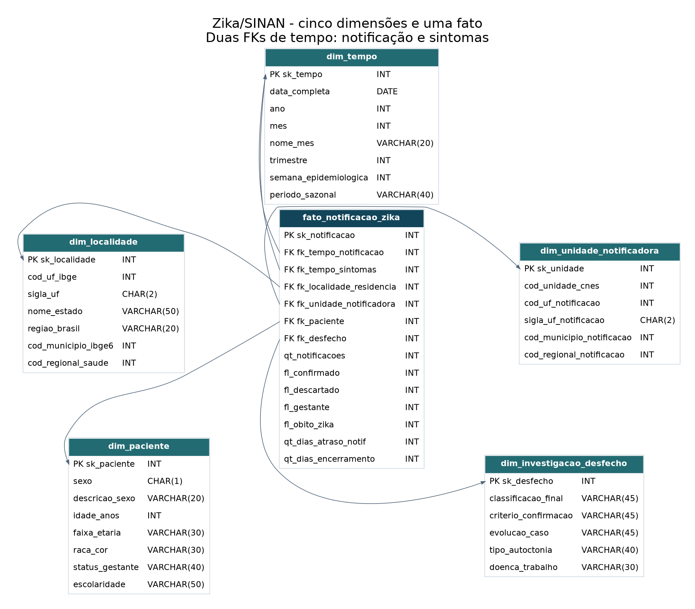

# Universidade Federal de Pernambuco
## Centro de Informática - CIn

**Integrantes (Nome - login):**
* Cauã Emanuel - `ceor@cin.ufpe.br`
* Allanis Beatriz - `aboml@cin.ufpe.br`
* Arthur Gabriel - `agsl@cin.ufpe.br`
* Allan Fernandes - `afl4@cin.ufpe.br`
* Felipe Melo - `fma4@cin.ufpe.br`
* Amanda Pereira - `apmo@cin.ufpe.br`

**TEMA:** Integração e Análise Dimensional das Notificações de Zika Vírus no Brasil no Triênio 2024–2026 (SINAN / Ministério da Saúde)

---

# Relatório do Projeto de Integração — Banco de Dados — 2026.2

---

## 1. Descrição da Base de Dados Unificada (Modelagem Dimensional e Dicionário de Dados)

O projeto integra três extrações de notificações de Zika do SINAN, identificadas como 2024, 2025 e 2026. A fonte temática declarada é o [portal do Ministério da Saúde](https://dadosabertos.saude.gov.br/dataset/arboviroses-zika-virus), consultado em 16/11/2026. A data original de download, os endereços diretos dos recursos e eventuais conversões anteriores aos CSVs não foram registrados. A reprodução desta entrega usa os arquivos preservados no repositório, identificados por hashes SHA-256 no [inventário das fontes](../dados/metadados_fontes.json).

| Extração | Linhas brutas | Colunas | Intervalo observado de DT_NOTIFIC |
|---|---:|---:|---|
| `ZIKABR24.csv` | 43.312 | 38 | 01/01/2024 a 24/02/2025 |
| `ZIKABR25.csv` | 25.764 | 38 | 29/12/2024 a 12/02/2026 |
| `ZIKABR26.csv` | 13.384 | 38 | 04/01/2026 a 05/10/2026 |
| **Total bruto** | **82.460** | **38 campos comuns** | **2026 parcial** |

O cabeçalho é igual nos três arquivos. O ano da data pode diferir do ano indicado no nome: 69 linhas no arquivo de 2024 e 12 no de 2025 apresentam essa situação. Esses dados são preservados e o calendário analítico usa `DT_NOTIFIC`. Os limites de datas não comprovam completude dos períodos. A [documentação das fontes](../dados/README_DADOS.md) detalha o inventário e suas limitações.

### 1.1. Arquitetura do esquema estrela

O Data Warehouse possui uma tabela fato e cinco dimensões, compartilhadas pelos pipelines ETL e ELT. Os nomes físicos no MySQL são minúsculos.

*Figura 1 — Estrutura física comum aos dois fluxos. As setas saem das FKs da fato para as PKs das dimensões. Fonte: contrato e DDL do projeto. [Versão vetorial](figuras/esquema_estrela.svg) e [fonte editável Graphviz](figuras/esquema_estrela.dot).*

| Tabela | Papel |
|---|---|
| `fato_notificacao_zika` | Registro integrado e suas métricas; referencia os seis papéis dimensionais por FK. |
| `dim_tempo` | Calendário compartilhado por duas FKs: data da notificação e data dos primeiros sintomas. Não são duas tabelas diferentes. |
| `dim_localidade` | UF, município e regional de residência; permite distinguir residência de atendimento. |
| `dim_unidade_notificadora` | Unidade CNES e localização da notificação. |
| `dim_paciente` | Combinação de atributos sociodemográficos e gestacionais, sem identificação de pessoa. |
| `dim_investigacao_desfecho` | Combinação de classificação, critério, evolução, autoctonia e doença relacionada ao trabalho. |

### 1.2. Granularidade, chaves e medidas

Uma linha da fato representa **uma linha válida distinta nos 38 valores textuais originais**. A deduplicação exata preserva a primeira ocorrência na ordem arquivo/linha. Registros com qualquer diferença de conteúdo permanecem distintos; não se infere identidade de caso ou de pessoa. Mesmo que duas linhas brutas diferentes resultem nos mesmos atributos analíticos, ambas permanecem na fato.

A chave `sk_notificacao` é substituta, não um identificador fornecido pelo SINAN. As dimensões de perfil recebem chaves sequenciais pela ordenação das combinações; `dim_tempo` usa YYYYMMDD. A estabilidade dessas chaves refere-se à mesma entrada e às mesmas regras: elas podem mudar em outra carga. Há um membro desconhecido SK=0 em cada dimensão; sintomas sem data usam essa referência, enquanto combinações de perfil desconhecidas são materializadas com suas próprias SKs.

`qt_notificacoes=1` permite somar registros. As flags de confirmação, descarte, gestação e óbito pelo agravo permitem somas por recorte. Os intervalos de notificação e encerramento são métricas anuláveis: médias usam apenas os valores válidos, devendo ser acompanhadas da quantidade de observações. Nenhuma dessas medidas representa incidência sem denominador populacional.

As seis tabelas usam InnoDB, `utf8mb4_0900_bin`, PKs e seis FKs físicas. O DDL restringe flags a 0/1, quantidade a 1 e intervalos não nulos a 0–365 dias. A publicação carrega dimensões antes da fato e substitui seus conteúdos em uma transação; uma falha provoca rollback. O calendário é formado pelas datas observadas de notificação e sintomas, não por todos os dias de um intervalo contínuo.

### 1.3. Dicionário de dados

O [dicionário completo](dicionario_de_dados_e_mapeamento_de_divergencias.md) integra a documentação do relatório e contém os atributos das seis tabelas, tipos com comprimentos, nulabilidade, origem e regras de cálculo. Ele deve acompanhar qualquer exportação do relatório como anexo ou arquivo vinculado. O [contrato executável](../pipelines/contrato.json) e o [DDL compartilhado](../sql/01_script_ddl_do_esquema_estrela.sql) são as referências físicas para reprodução.

---

## 2. Explicação Detalhada do Processo de Integração

*(Nota para a Macroentrega 2: As Duplas 1 e 2 devem inserir aqui os prints intermediários da execução dos notebooks ETL e ELT).*

O processo de integração dos três arquivos anuais (`ZIKABR24.csv`, `ZIKABR25.csv` e `ZIKABR26.csv`) foi estruturado em quatro etapas:

1. **Coleta e Ingestão Unificada:** Leitura dos três arquivos CSV referentes aos anos de $2024$, $2025$ e $2026$, adicionando uma coluna de metadado de rastreabilidade (`arquivo_origem`) para identificar a qual extração anual cada registro pertence originalmente.
2. **Calendário e Deduplicação Exata:** O nome do arquivo pode diferir do ano de `DT_NOTIFIC`, como demonstrado no inventário. O calendário usa a data efetiva, sem descartar essas linhas. A deduplicação compara os 38 campos textuais e remove somente cópias idênticas, dentro ou entre arquivos; linhas diferentes não são presumidas como o mesmo caso.
3. **Padronização e Decodificação de Domínios:** Conversão das variáveis codificadas numericamente (como `NU_IDADE_N`, `CS_GESTANT`, `CS_RACA`, `CLASSI_FIN`, `CRITERIO`, `EVOLUCAO` e `SG_UF`) em descrições analíticas legíveis para compor as dimensões.
4. **Geração de Chaves Substitutas (*Surrogate Keys*) e Carga Dimensional:** Povoamento das 5 tabelas dimensão com registros únicos e inserção dos eventos e métricas calculadas na tabela fato `FATO_NOTIFICACAO_ZIKA`.

---

## 3. Justificativa da Escolha da Base de Dados

A base de Zika foi escolhida por reunir notificações de um mesmo tema em três extrações anuais consecutivas e permitir relacionar tempo, residência, atendimento, perfil do paciente e investigação. O [Ministério da Saúde](https://dadosabertos.saude.gov.br/dataset/arboviroses-zika-virus) descreve o SINAN como um sistema de suporte à investigação e à análise da vigilância epidemiológica. No projeto, os campos de gestação e desfecho permitem formular perguntas sobre notificações em gestantes e sua classificação, dentro dos limites da informação disponível.

A estrutura comum de 38 campos facilita a integração sem eliminar os desafios de qualidade. A auditoria encontrou diferenças entre o ano do arquivo e o ano da data de notificação, duplicatas exatas e preenchimento desigual de campos de investigação. Por exemplo, `CLASSI_FIN` está vazio em 537, 433 e 754 registros nos arquivos de 2024, 2025 e 2026, respectivamente. A comparação deve considerar também os tamanhos das extrações. Esses fatos estão registrados no [inventário reprodutível](../dados/metadados_fontes.json).

Do ponto de vista técnico, a escolha permite demonstrar: (a) decodificação de idade composta e domínios; (b) calendário derivado da data efetiva; (c) deduplicação entre e dentro dos arquivos; (d) construção de chaves e dimensões; e (e) tratamento de desconhecidos e intervalos inválidos. Aplicar o mesmo contrato em Python e no MySQL permite comparar ETL e ELT sem atribuir à ordem de processamento diferenças provocadas por regras de negócio incompatíveis.

A organização dimensional dá suporte às três perguntas analíticas do projeto: evolução mensal das notificações; notificações e confirmações em gestantes por UF de residência; e tempos até notificação e encerramento por região. A modelagem foi escolhida para tornar esses cruzamentos explícitos, sem afirmar ganho de desempenho não medido.

Os resultados descrevem a versão local das notificações. O arquivo de 2026 é parcial; investigações podem estar incompletas; não há denominadores populacionais ou identificador único de pessoa/caso na extração. Por isso, o projeto não estima incidência, risco individual, causalidade ou transmissão a partir apenas das contagens, nem considera reduções de contagem como evidência automática de melhora epidemiológica.

---

## 4. Descrição dos Processos de Transformação Aplicados

Os dois fluxos implementam o mesmo [contrato](../pipelines/contrato.json). No ETL, `extract`, `transform` e `star` em [pipelines/core.py](../pipelines/core.py) leem o texto, transformam os registros e constroem as dimensões em memória antes da carga. No ELT, o texto é carregado em `stg_zika`, com `arquivo_origem` e `linha_origem`; os [modelos SQL dbt](../dbt/models/) fazem a transformação no MySQL. A publicação de ambos usa o mesmo DDL.

### 4.1. Regras aplicadas e exemplos

| Etapa | Regra efetiva | Exemplo de entrada → saída |
|---|---|---|
| Leitura | Preservar valores textuais dos 38 campos e acrescentar arquivo/linha de origem | Linha 2 de `ZIKABR24.csv` → metadados de origem na ingestão |
| Deduplicação | Comparar os 38 textos antes de qualquer conversão, preservando a primeira ocorrência | Duas linhas idênticas em qualquer arquivo → um registro; `26` e `26.0` são diferentes na comparação bruta |
| Data obrigatória | Remover espaços e validar `DT_NOTIFIC` em YYYY-MM-DD; anos 1000–9999 | `2024-02-30` → quarentena, sem publicação na fato |
| Datas opcionais | Datas impossíveis/ausentes de sintomas e encerramento tornam-se NULL | Sintomas ausentes → `fk_tempo_sintomas=0` e atraso NULL |
| Calendário | Usar a data de notificação, não o ano do arquivo ou `NU_ANO` | Data `2025-01-02` em arquivo de 2024 → ano analítico 2025 |
| Códigos | Converter inteiros textuais e representações com parte decimal zero | `26.0` → 26; escolaridade `0` → Analfabeto |
| Geografia | Mapear UFs pelo contrato, sem inferir residência pelo atendimento | `SG_UF=26` → PE/Pernambuco/Nordeste; residência vazia → NI/Não Informado |
| Idade | Códigos 1000–3999 → 0 anos; 4000–4120 → código menos 4000; demais → NULL | `4030.0` → 30 anos / 30 a 44 anos; `4121` → NULL / Ignorado |
| Domínios | Decodificar sexo, raça/cor, gestação, escolaridade e investigação; usar padrão em valores desconhecidos | `CS_GESTANT=4` → Idade Gestacional Ignorada; `fl_gestante=1` |
| Indicadores | Confirmação: `CLASSI_FIN=1`; descarte: `=2`; gestação: códigos 1–4; óbito pelo agravo: `EVOLUCAO=2` | `EVOLUCAO=3` → Óbito por outras causas; `fl_obito_zika=0` |
| Intervalos | Calcular diferença de datas; manter 0–365 dias e converter demais intervalos em NULL | Sintomas posteriores à notificação → atraso NULL, preservando a notificação |
| Chaves | Gerar dimensões por combinações distintas e publicar suas PKs na fato | Duas datas de uma notificação → duas FKs para `dim_tempo` |

Os exemplos ilustram o contrato e não são apresentados como transcrições de linhas reais dos CSVs. As faixas de idade são 0–14, 15–29, 30–44, 45–59, 60+ e Ignorado. A semana é calculada com início no domingo e primeira semana com pelo menos quatro dias do ano, conforme a regra comum implementada. Os rótulos de sazonalidade Jan–Mai/Jun–Dez são uma classificação fixa do projeto, não uma conclusão demonstrada pelos gráficos.

`ID_AGRAVO` e `COUFINF` participam da comparação bruta para deduplicação e permanecem nos CSVs e no staging ELT; não são atributos promovidos à estrela. O código atual não executa a limpeza dessas colunas descrita no PDF comparativo histórico. O detalhamento de todos os campos usados e não usados consta no dicionário.

### 4.2. Reconciliação, publicação e limites

Na versão auditada, **82.460 brutas = 56 duplicatas exatas + 0 rejeições por data de notificação + 82.404 válidas**. As duplicatas são removidas dentro do conjunto consolidado, inclusive quando pertencem ao mesmo arquivo. O limite de 365 dias é uma regra de qualidade do projeto; não equivale a prazo clínico ou normativo de encerramento.

Campos desconhecidos usam NULL ou os padrões documentados, preservando o registro quando a data obrigatória é válida. Intervalos inválidos não excluem notificações. As dimensões são publicadas antes da fato e a integridade é aplicada pelas FKs do MySQL; a troca dos conteúdos finais é transacional. O ELT mantém staging e modelos intermediários, enquanto o ETL transforma antes da conexão de publicação.

Os seis testes Python foram aprovados em 16/11/2026, incluindo reconciliação, regras de borda e correspondência contrato/DDL/modelos. A validação MySQL de 13/11 está documentada em [validação dos pipelines](validacao_pipelines.md); ela não substitui as evidências da execução Colab que acompanham a entrega. As análises devem usar essa mesma versão deduplicada e explicitar o recorte parcial de 2026.

---

## 5. Comparativo entre ETL e ELT

*(Nota para a Macroentrega 3: Preencher os tempos medidos na execução dos notebooks no Google Colab).*

| Critério Analisado | Pipeline ETL (Python / Pandas $\rightarrow$ BD) | Pipeline ELT (Carga Staging $\rightarrow$ SQL no SGBD) |
| :--- | :--- | :--- |
| **Fluxo de Processamento** | Os 3 CSVs (`2024`, `2025`, `2026`) são lidos, limpos e modelados em *DataFrames* no Pandas antes de inserir no banco. | Os 3 CSVs são carregados diretamente em tabelas brutas (`stg_zika`, com arquivo e linha de origem) e transformados via SQL. |
| **Decodificação de Domínios (`NU_IDADE_N`, `CS_GESTANT`, UF)** | Deduplicação com Pandas e decodificação por funções Python e domínios do contrato em `transform`. | Realizada via expressões declarativas `CASE WHEN` e `COALESCE` diretamente nas queries `INSERT INTO ... SELECT`. |
| **Deduplicação e Geração de Dimensões** | Exige `.drop_duplicates()` em memória e controle manual de índices para gerar as *Surrogate Keys* (`sk_`). | O próprio SGBD garante unicidade via `DISTINCT` / `GROUP BY` e chaves `ROW_NUMBER()`. |
| **Reprocessamento e Auditoria** | Qualquer mudança em regra de negócio exige reler os CSVs do disco e rodar todo o script Python novamente. | O staging preserva o texto para auditoria. O comando ELT completo relê os CSVs, recarrega staging e executa dbt; retransformação isolada requer procedimento específico e medição própria. |
| **Tempo Total de Execução (Colab)** | `[Inserir tempo medido na Macroentrega 3]` | `[Inserir tempo medido na Macroentrega 3]` |

---

## 6. Apresentação de Três Análises e Insights

As consultas, gráficos e exportações estão em [`notebooks/analises_zika.ipynb`](../notebooks/analises_zika.ipynb),
executado após ETL ou ELT. Os pipelines contêm apenas reconciliação e validações operacionais.

1. **Sazonalidade:** evolução mensal de notificações por ano real de `DT_NOTIFIC`.
2. **Gestantes:** notificações e confirmações por UF de residência, incluindo a categoria NI.
3. **Vigilância:** médias de atraso de notificação e tempo de encerramento por região,
   considerando apenas intervalos válidos de 0 a 365 dias.

Os gráficos são exportados para `saidas/analises/`. As conclusões devem ser registradas após
executar as análises sobre a versão atual, sem reutilizar estatísticas da carga anterior.
2026 é parcial; contagens absolutas de notificações não medem incidência populacional.

---

## 7. Reflexão sobre o Aprendizado

*(Nota para a Macroentrega 4: Revisar com todo o grupo antes da entrega final em 18/11).*

O desenvolvimento deste projeto permitiu ao grupo vivenciar na prática os desafios reais da construção de um Data Warehouse a partir de microdados governamentais de saúde pública (SINAN/DataSUS). Os principais aprendizados incluem:

1. **Compreensão Profunda das Anomalias em Séries Históricas Reais:** Mesmo trabalhando com uma única fonte temática (Zika Vírus) em três anos consecutivos ($2024$, $2025$ e $2026$), verificamos que dados brutos exigem intenso saneamento devido a vazamentos de semanas epidemiológicas entre arquivos anuais, campos numéricos lidos como *float* por presença de nulos e códigos compostos legados (como `NU_IDADE_N`).
2. **Desnormalização Consciente no Esquema Estrela:** A separação da tabela única do SINAN em cinco dimensões (`DIM_TEMPO`, `DIM_LOCALIDADE`, `DIM_UNIDADE_NOTIFICADORA`, `DIM_PACIENTE` e `DIM_INVESTIGACAO_DESFECHO`) e uma tabela fato central tornou as consultas analíticas das três análises muito mais legíveis, rápidas e semânticas.
3. **Domínio Prático de ETL vs. ELT:** A implementação paralela dos dois pipelines deixou claro como o **ETL em Python/Pandas** facilita a manipulação imperativa de tipos e strings na memória, enquanto o **ELT em SQL** brilha pela simplicidade declarativa, velocidade de agregação em conjunto (*set-based operations*) e manutenção das tabelas *Staging* para auditoria.